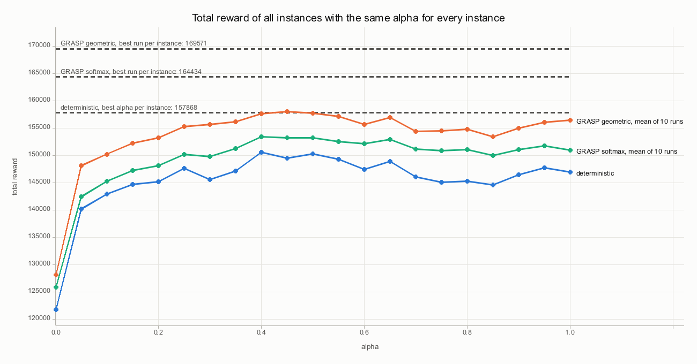
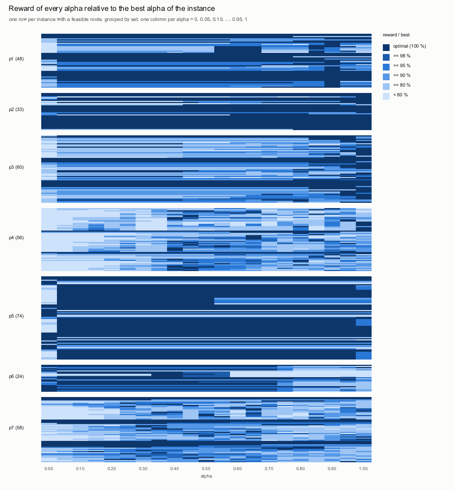

# Rejilla de α: heurística PJS determinista y GRASP

Informe generado por `pjs` (`TOP/src/rust`); se regenera con

```
cd TOP
ignore/target/release/pjs.exe grid --reps 10 --iters 10 --geometric 0.3 --softmax 1 --seed 1 \
    --png-dir results/figures/routes --report docs/informe_alpha.md src/data/top-data results
```

## Método

La heurística de ahorros de Panadero et al. (2021, sección 4) construye una ruta *dummy* origen → i → destino por cliente (descartando los que ni solos caben en `tmax`), ordena los arcos por el ahorro enriquecido s'ᵢⱼ = α·sᵢⱼ + (1 − α)·(uᵢ + uⱼ), fusiona rutas siguiendo esa lista mientras no se supere `tmax` y se queda con las m rutas de más recompensa. El paper no da ningún valor de α, así que cada instancia se resuelve con los **21 valores α = 0, 0.05, 0.10, ..., 0.95, 1**.

- **Determinista:** una construcción por α, tomando siempre el arco de mayor ahorro.
- **GRASP** (solo construcción, sin búsqueda local): para cada α, 10 ejecuciones con la **geométrica** (β = 0.3) y 10 con el **softmax** (τ = 1). Cada ejecución sigue el multiarranque de Li et al. (2022, Algoritmo 1) y cada hilo del Algoritmo 1 de Panadero: parte de la solución determinista y hace **10 construcciones aleatorias**, quedándose con la mejor. Cada ejecución tiene su propia semilla (derivada de la semilla base 1, la instancia, α, la aleatorización y el número de ejecución), así que sus resultados son distintos entre sí y el experimento es reproducible.
- **Geométrica:** el siguiente arco es el k-ésimo de los que quedan, con k ~ Geom(β). **Softmax:** cada arco que queda se elige con probabilidad exp(s'/τ) / Σ exp(s'/τ).
- **Criterio:** solo cuenta la recompensa total; las rutas solo tienen que respetar `tmax`.
- **Ejecución:** las 170667 tareas (instancia, α, construcción determinista o ejecución de GRASP) se reparten en paralelo con rayon (127 s). Cada solución se comprueba de forma independiente (como mucho m rutas, ningún cliente repetido, cada ruta dentro de `tmax`, tiempos y recompensas recalculados).
- **Datos:** 387 instancias de Chao et al. (1996). En 34 de ellas ningún cliente es alcanzable ni con una ruta de un solo cliente, así que su recompensa es 0; el análisis usa las 353 restantes.

## Resultados globales

**Determinista.** α influye en **285 de 353** instancias. Con el mejor α de cada instancia la recompensa total es **157868**; el mejor α común a todas es **α = 0.40**, que da 150585 (4.61 % menos) y solo es óptimo en 170 instancias.

| | Recompensa total | Frente al determinista con su mejor α | Instancias que mejora |
|---|---|---|---|
| Determinista, mejor α de cada instancia | 157868 | — | — |
| GRASP geometric, mejor ejecución de cada instancia | 169571 | +7.41 % | 243 |
| GRASP geometric, mejor media de 10 ejecuciones (mejor α de cada instancia) | 164834.9 | +4.41 % | 222 |
| GRASP geometric, media de 10 ejecuciones con el mejor α común (α = 0.45) | 158016.3 | +0.09 % | — |
| GRASP softmax, mejor ejecución de cada instancia | 164434 | +4.16 % | 189 |
| GRASP softmax, mejor media de 10 ejecuciones (mejor α de cada instancia) | 159691.7 | +1.16 % | 148 |
| GRASP softmax, media de 10 ejecuciones con el mejor α común (α = 0.40) | 153469.3 | -2.79 % | — |

*Mejor ejecución*: la mayor recompensa de cualquier ejecución de GRASP de la instancia, sobre todos los α. *Mejor media*: para cada α, la media de sus ejecuciones; se toma el α con la media más alta. La media es lo que cabe esperar de **una** ejecución de GRASP con ese α; la mejor ejecución, lo que se obtiene lanzando todas y quedándose con la mejor.



Cada línea es la recompensa total de todas las instancias si todas usan el mismo α (para GRASP, la media de sus ejecuciones); las discontinuas, lo que se obtiene eligiendo lo mejor de cada instancia.



Heurística determinista: cada fila es una instancia y cada columna un α; el azul más oscuro marca los α óptimos. Las zonas óptimas cambian de una instancia a otra y a menudo están partidas: pequeños cambios de α reordenan la lista de ahorros y la heurística voraz construye rutas distintas.

## Por conjunto

### Determinista

| Conjunto | Instancias | Con ruta factible | α influye | Mediana del menor α óptimo (donde α influye) | Recompensa (mejor α por instancia) | Mejor α común del conjunto | Recompensa con él | Pérdida |
|---|---|---|---|---|---|---|---|---|
| p1 | 54 | 48 | 35 | 0.55 | 5520 | 0.90 | 5450 | 1.27 % |
| p2 | 33 | 33 | 11 | 0.60 | 4540 | 1.00 | 4500 | 0.88 % |
| p3 | 60 | 60 | 52 | 0.95 | 22740 | 1.00 | 22300 | 1.93 % |
| p4 | 60 | 56 | 54 | 0.65 | 32614 | 0.40 | 30700 | 5.87 % |
| p5 | 78 | 74 | 59 | 0.05 | 51120 | 0.05 | 50305 | 1.59 % |
| p6 | 42 | 24 | 23 | 0.00 | 15930 | 0.35 | 15678 | 1.58 % |
| p7 | 60 | 58 | 51 | 0.45 | 25404 | 0.50 | 24145 | 4.96 % |

### GRASP

| Conjunto | Determinista (mejor α) | geometric: mejor ejecución | geometric: mejor media | softmax: mejor ejecución | softmax: mejor media |
|---|---|---|---|---|---|
| p1 | 5520 | 5730 (+3.80 %) | 5607.5 (+1.59 %) | 5715 (+3.53 %) | 5581.5 (+1.11 %) |
| p2 | 4540 | 4615 (+1.65 %) | 4577.5 (+0.83 %) | 4610 (+1.54 %) | 4581.5 (+0.91 %) |
| p3 | 22740 | 23870 (+4.97 %) | 23461.0 (+3.17 %) | 23660 (+4.05 %) | 22992.0 (+1.11 %) |
| p4 | 32614 | 35252 (+8.09 %) | 33982.2 (+4.20 %) | 32919 (+0.94 %) | 32626.6 (+0.04 %) |
| p5 | 51120 | 56185 (+9.91 %) | 54520.0 (+6.65 %) | 53605 (+4.86 %) | 51911.0 (+1.55 %) |
| p6 | 15930 | 16734 (+5.05 %) | 16321.2 (+2.46 %) | 16806 (+5.50 %) | 16245.0 (+1.98 %) |
| p7 | 25404 | 27185 (+7.01 %) | 26365.5 (+3.78 %) | 27119 (+6.75 %) | 25754.1 (+1.38 %) |

## Por instancia

Instancias con alguna ruta factible. *Menor α óptimo* es el menor α con la mayor recompensa determinista (el de la figura de rutas) y *α óptimos* cuántos de la rejilla la alcanzan. Para GRASP, cada celda es la recompensa y, entre paréntesis, su α.

| Instancia | m | tmax | Menor α óptimo | α óptimos | Determinista | Peor α | geometric: mejor ejecución | geometric: mejor media | softmax: mejor ejecución | softmax: mejor media | Rutas |
|---|---|---|---|---|---|---|---|---|---|---|---|
| p1.2.b | 2 | 5 | 0.00 | 21 | 15 | 15 | 15 (0.00) | 15.0 (0.00) | 15 (0.00) | 15.0 (0.00) | [png](../results/figures/routes/p1.2.b.png) |
| p1.2.c | 2 | 7.5 | 0.00 | 21 | 20 | 20 | 20 (0.00) | 20.0 (0.00) | 20 (0.00) | 20.0 (0.00) | [png](../results/figures/routes/p1.2.c.png) |
| p1.2.d | 2 | 10 | 0.00 | 16 | 30 | 25 | 30 (0.00) | 30.0 (0.00) | 30 (0.00) | 30.0 (0.00) | [png](../results/figures/routes/p1.2.d.png) |
| p1.2.e | 2 | 12.5 | 0.00 | 21 | 40 | 40 | 45 (0.00) | 45.0 (0.00) | 45 (0.00) | 45.0 (0.35) | [png](../results/figures/routes/p1.2.e.png) |
| p1.2.f | 2 | 15 | 0.90 | 3 | 75 | 65 | 80 (0.85) | 76.0 (1.00) | 80 (0.65) | 77.0 (0.95) | [png](../results/figures/routes/p1.2.f.png) |
| p1.2.g | 2 | 17.5 | 0.05 | 11 | 75 | 65 | 85 (0.05) | 84.0 (0.40) | 85 (0.20) | 78.0 (0.20) | [png](../results/figures/routes/p1.2.g.png) |
| p1.2.h | 2 | 20 | 0.80 | 5 | 90 | 75 | 100 (0.10) | 95.0 (0.70) | 110 (0.70) | 95.5 (0.85) | [png](../results/figures/routes/p1.2.h.png) |
| p1.2.i | 2 | 23 | 0.05 | 20 | 120 | 100 | 130 (0.05) | 126.0 (0.30) | 130 (0.55) | 122.0 (0.55) | [png](../results/figures/routes/p1.2.i.png) |
| p1.2.j | 2 | 25 | 0.90 | 1 | 130 | 95 | 140 (0.90) | 133.5 (0.90) | 135 (0.70) | 130.5 (0.90) | [png](../results/figures/routes/p1.2.j.png) |
| p1.2.k | 2 | 27.5 | 0.90 | 1 | 165 | 115 | 165 (0.05) | 165.0 (0.90) | 165 (0.90) | 165.0 (0.90) | [png](../results/figures/routes/p1.2.k.png) |
| p1.2.l | 2 | 30 | 0.85 | 2 | 180 | 125 | 185 (0.20) | 181.0 (0.85) | 180 (0.80) | 180.0 (0.85) | [png](../results/figures/routes/p1.2.l.png) |
| p1.2.m | 2 | 32.5 | 0.55 | 6 | 200 | 120 | 200 (0.05) | 200.0 (0.55) | 200 (0.55) | 200.0 (0.55) | [png](../results/figures/routes/p1.2.m.png) |
| p1.2.n | 2 | 35 | 0.55 | 4 | 230 | 130 | 235 (0.10) | 230.0 (0.55) | 230 (0.55) | 230.0 (0.55) | [png](../results/figures/routes/p1.2.n.png) |
| p1.2.o | 2 | 36.5 | 0.55 | 4 | 235 | 130 | 240 (0.25) | 235.0 (0.55) | 235 (0.55) | 235.0 (0.55) | [png](../results/figures/routes/p1.2.o.png) |
| p1.2.p | 2 | 37.5 | 0.55 | 3 | 240 | 145 | 240 (0.25) | 240.0 (0.55) | 240 (0.55) | 240.0 (0.55) | [png](../results/figures/routes/p1.2.p.png) |
| p1.2.q | 2 | 40 | 0.55 | 5 | 245 | 125 | 250 (0.05) | 246.5 (0.65) | 245 (0.55) | 245.0 (0.55) | [png](../results/figures/routes/p1.2.q.png) |
| p1.2.r | 2 | 42.5 | 0.55 | 4 | 270 | 135 | 275 (0.45) | 271.5 (0.55) | 270 (0.55) | 270.0 (0.55) | [png](../results/figures/routes/p1.2.r.png) |
| p1.3.c | 3 | 5 | 0.00 | 21 | 15 | 15 | 15 (0.00) | 15.0 (0.00) | 15 (0.00) | 15.0 (0.00) | [png](../results/figures/routes/p1.3.c.png) |
| p1.3.d | 3 | 6.7 | 0.00 | 21 | 15 | 15 | 15 (0.00) | 15.0 (0.00) | 15 (0.00) | 15.0 (0.00) | [png](../results/figures/routes/p1.3.d.png) |
| p1.3.e | 3 | 8.3 | 0.00 | 21 | 30 | 30 | 30 (0.00) | 30.0 (0.00) | 30 (0.00) | 30.0 (0.00) | [png](../results/figures/routes/p1.3.e.png) |
| p1.3.f | 3 | 10 | 0.00 | 16 | 40 | 35 | 40 (0.00) | 40.0 (0.00) | 40 (0.00) | 40.0 (0.00) | [png](../results/figures/routes/p1.3.f.png) |
| p1.3.g | 3 | 11.7 | 0.00 | 21 | 50 | 50 | 50 (0.00) | 50.0 (0.00) | 50 (0.00) | 50.0 (0.00) | [png](../results/figures/routes/p1.3.g.png) |
| p1.3.h | 3 | 13.3 | 0.00 | 18 | 70 | 65 | 70 (0.00) | 70.0 (0.00) | 70 (0.00) | 70.0 (0.00) | [png](../results/figures/routes/p1.3.h.png) |
| p1.3.i | 3 | 15.3 | 0.05 | 20 | 95 | 85 | 95 (0.00) | 95.0 (0.05) | 100 (0.40) | 98.5 (0.70) | [png](../results/figures/routes/p1.3.i.png) |
| p1.3.j | 3 | 16.7 | 0.05 | 18 | 95 | 85 | 100 (0.00) | 95.0 (0.05) | 100 (0.00) | 98.0 (0.80) | [png](../results/figures/routes/p1.3.j.png) |
| p1.3.k | 3 | 18.3 | 0.90 | 1 | 120 | 100 | 130 (0.20) | 120.0 (0.90) | 125 (0.40) | 120.5 (0.90) | [png](../results/figures/routes/p1.3.k.png) |
| p1.3.l | 3 | 20 | 0.80 | 5 | 125 | 110 | 135 (0.20) | 127.0 (0.80) | 140 (0.80) | 130.0 (0.80) | [png](../results/figures/routes/p1.3.l.png) |
| p1.3.m | 3 | 21.7 | 0.00 | 6 | 135 | 120 | 155 (0.05) | 150.5 (0.80) | 160 (0.55) | 144.5 (0.55) | [png](../results/figures/routes/p1.3.m.png) |
| p1.3.n | 3 | 23.3 | 0.05 | 13 | 175 | 145 | 185 (0.05) | 179.0 (0.25) | 180 (0.60) | 175.5 (0.60) | [png](../results/figures/routes/p1.3.n.png) |
| p1.3.o | 3 | 24.3 | 0.90 | 1 | 195 | 150 | 200 (0.80) | 198.0 (0.90) | 195 (0.75) | 195.0 (0.90) | [png](../results/figures/routes/p1.3.o.png) |
| p1.3.p | 3 | 25 | 0.90 | 1 | 190 | 135 | 200 (0.85) | 193.0 (0.90) | 190 (0.80) | 190.0 (0.90) | [png](../results/figures/routes/p1.3.p.png) |
| p1.3.q | 3 | 26.7 | 0.90 | 2 | 215 | 155 | 220 (0.15) | 215.0 (0.90) | 215 (0.90) | 215.0 (0.90) | [png](../results/figures/routes/p1.3.q.png) |
| p1.3.r | 3 | 28.3 | 0.90 | 1 | 225 | 170 | 230 (0.25) | 227.0 (0.90) | 225 (0.90) | 225.0 (0.90) | [png](../results/figures/routes/p1.3.r.png) |
| p1.4.d | 4 | 5 | 0.00 | 21 | 15 | 15 | 15 (0.00) | 15.0 (0.00) | 15 (0.00) | 15.0 (0.00) | [png](../results/figures/routes/p1.4.d.png) |
| p1.4.e | 4 | 6.2 | 0.00 | 21 | 15 | 15 | 15 (0.00) | 15.0 (0.00) | 15 (0.00) | 15.0 (0.00) | [png](../results/figures/routes/p1.4.e.png) |
| p1.4.f | 4 | 7.5 | 0.00 | 21 | 25 | 25 | 25 (0.00) | 25.0 (0.00) | 25 (0.00) | 25.0 (0.00) | [png](../results/figures/routes/p1.4.f.png) |
| p1.4.g | 4 | 8.8 | 0.00 | 21 | 35 | 35 | 35 (0.00) | 35.0 (0.00) | 35 (0.00) | 35.0 (0.00) | [png](../results/figures/routes/p1.4.g.png) |
| p1.4.h | 4 | 10 | 0.00 | 21 | 45 | 45 | 45 (0.00) | 45.0 (0.00) | 45 (0.00) | 45.0 (0.00) | [png](../results/figures/routes/p1.4.h.png) |
| p1.4.i | 4 | 11.5 | 0.05 | 20 | 60 | 55 | 60 (0.00) | 60.0 (0.05) | 60 (0.00) | 60.0 (0.05) | [png](../results/figures/routes/p1.4.i.png) |
| p1.4.j | 4 | 12.5 | 0.00 | 21 | 70 | 70 | 75 (0.00) | 74.5 (0.00) | 75 (0.00) | 75.0 (0.15) | [png](../results/figures/routes/p1.4.j.png) |
| p1.4.k | 4 | 13.8 | 0.05 | 20 | 95 | 90 | 100 (0.05) | 99.0 (0.30) | 100 (0.00) | 99.0 (0.60) | [png](../results/figures/routes/p1.4.k.png) |
| p1.4.l | 4 | 15 | 0.05 | 20 | 120 | 105 | 120 (0.05) | 120.0 (0.05) | 120 (0.00) | 120.0 (0.05) | [png](../results/figures/routes/p1.4.l.png) |
| p1.4.m | 4 | 16.2 | 0.90 | 1 | 115 | 100 | 120 (0.10) | 116.0 (0.10) | 125 (0.15) | 119.5 (0.70) | [png](../results/figures/routes/p1.4.m.png) |
| p1.4.n | 4 | 17.5 | 0.05 | 16 | 135 | 125 | 145 (0.05) | 143.0 (0.10) | 145 (0.05) | 137.0 (0.05) | [png](../results/figures/routes/p1.4.n.png) |
| p1.4.o | 4 | 18.2 | 0.90 | 1 | 150 | 130 | 155 (0.10) | 150.0 (0.90) | 155 (0.40) | 150.0 (0.90) | [png](../results/figures/routes/p1.4.o.png) |
| p1.4.p | 4 | 18.8 | 0.90 | 1 | 165 | 135 | 170 (0.10) | 165.0 (0.90) | 170 (0.80) | 165.0 (0.90) | [png](../results/figures/routes/p1.4.p.png) |
| p1.4.q | 4 | 20 | 0.90 | 3 | 160 | 140 | 165 (0.05) | 160.0 (0.90) | 175 (0.70) | 162.5 (0.95) | [png](../results/figures/routes/p1.4.q.png) |
| p1.4.r | 4 | 21.2 | 0.70 | 5 | 165 | 155 | 180 (0.85) | 172.0 (0.85) | 190 (0.85) | 168.5 (0.85) | [png](../results/figures/routes/p1.4.r.png) |
| p2.2.a | 2 | 7.5 | 0.00 | 21 | 80 | 80 | 90 (0.15) | 85.0 (1.00) | 90 (0.05) | 88.0 (1.00) | [png](../results/figures/routes/p2.2.a.png) |
| p2.2.b | 2 | 10 | 0.00 | 21 | 120 | 120 | 120 (0.00) | 120.0 (0.00) | 120 (0.00) | 120.0 (0.00) | [png](../results/figures/routes/p2.2.b.png) |
| p2.2.c | 2 | 11.5 | 0.00 | 21 | 110 | 110 | 140 (1.00) | 124.5 (0.20) | 140 (0.80) | 131.5 (1.00) | [png](../results/figures/routes/p2.2.c.png) |
| p2.2.d | 2 | 12.5 | 1.00 | 1 | 145 | 110 | 155 (1.00) | 149.0 (1.00) | 150 (0.85) | 145.0 (1.00) | [png](../results/figures/routes/p2.2.d.png) |
| p2.2.e | 2 | 13.5 | 0.05 | 20 | 190 | 145 | 190 (0.05) | 190.0 (0.05) | 190 (0.05) | 190.0 (0.05) | [png](../results/figures/routes/p2.2.e.png) |
| p2.2.f | 2 | 15 | 0.05 | 20 | 200 | 190 | 200 (0.00) | 200.0 (0.05) | 200 (0.00) | 200.0 (0.05) | [png](../results/figures/routes/p2.2.f.png) |
| p2.2.g | 2 | 16 | 0.00 | 21 | 200 | 200 | 200 (0.00) | 200.0 (0.00) | 200 (0.00) | 200.0 (0.00) | [png](../results/figures/routes/p2.2.g.png) |
| p2.2.h | 2 | 17.5 | 0.95 | 2 | 230 | 165 | 230 (0.45) | 230.0 (0.85) | 230 (0.35) | 230.0 (0.95) | [png](../results/figures/routes/p2.2.h.png) |
| p2.2.i | 2 | 19 | 0.05 | 16 | 230 | 190 | 230 (0.00) | 230.0 (0.05) | 230 (0.00) | 230.0 (0.05) | [png](../results/figures/routes/p2.2.i.png) |
| p2.2.j | 2 | 20 | 1.00 | 1 | 260 | 180 | 260 (0.35) | 260.0 (1.00) | 260 (0.45) | 260.0 (1.00) | [png](../results/figures/routes/p2.2.j.png) |
| p2.2.k | 2 | 22.5 | 0.45 | 10 | 245 | 215 | 265 (1.00) | 254.0 (0.65) | 265 (0.65) | 252.0 (0.70) | [png](../results/figures/routes/p2.2.k.png) |
| p2.3.a | 3 | 5 | 0.00 | 21 | 70 | 70 | 70 (0.00) | 70.0 (0.00) | 70 (0.00) | 70.0 (0.00) | [png](../results/figures/routes/p2.3.a.png) |
| p2.3.b | 3 | 6.7 | 0.00 | 21 | 70 | 70 | 70 (0.00) | 70.0 (0.00) | 70 (0.00) | 70.0 (0.00) | [png](../results/figures/routes/p2.3.b.png) |
| p2.3.c | 3 | 7.7 | 0.00 | 21 | 105 | 105 | 105 (0.00) | 105.0 (0.00) | 105 (0.00) | 105.0 (0.00) | [png](../results/figures/routes/p2.3.c.png) |
| p2.3.d | 3 | 8.3 | 0.00 | 21 | 105 | 105 | 105 (0.00) | 105.0 (0.00) | 105 (0.00) | 105.0 (0.00) | [png](../results/figures/routes/p2.3.d.png) |
| p2.3.e | 3 | 9 | 0.00 | 21 | 120 | 120 | 120 (0.00) | 120.0 (0.00) | 120 (0.00) | 120.0 (0.00) | [png](../results/figures/routes/p2.3.e.png) |
| p2.3.f | 3 | 10 | 0.00 | 21 | 120 | 120 | 120 (0.00) | 120.0 (0.00) | 120 (0.00) | 120.0 (0.00) | [png](../results/figures/routes/p2.3.f.png) |
| p2.3.g | 3 | 10.7 | 1.00 | 1 | 135 | 125 | 140 (0.00) | 140.0 (0.00) | 140 (0.00) | 140.0 (0.00) | [png](../results/figures/routes/p2.3.g.png) |
| p2.3.h | 3 | 11.7 | 0.05 | 16 | 165 | 150 | 165 (0.00) | 165.0 (0.05) | 165 (0.00) | 165.0 (0.05) | [png](../results/figures/routes/p2.3.h.png) |
| p2.3.i | 3 | 12.7 | 0.60 | 9 | 200 | 170 | 200 (0.00) | 200.0 (0.60) | 200 (0.00) | 200.0 (0.60) | [png](../results/figures/routes/p2.3.i.png) |
| p2.3.j | 3 | 13.3 | 0.00 | 21 | 200 | 200 | 200 (0.00) | 200.0 (0.00) | 200 (0.00) | 200.0 (0.00) | [png](../results/figures/routes/p2.3.j.png) |
| p2.3.k | 3 | 15 | 0.00 | 21 | 200 | 200 | 200 (0.00) | 200.0 (0.00) | 200 (0.00) | 200.0 (0.00) | [png](../results/figures/routes/p2.3.k.png) |
| p2.4.a | 4 | 3.8 | 0.00 | 21 | 10 | 10 | 10 (0.00) | 10.0 (0.00) | 10 (0.00) | 10.0 (0.00) | [png](../results/figures/routes/p2.4.a.png) |
| p2.4.b | 4 | 5 | 0.00 | 21 | 70 | 70 | 70 (0.00) | 70.0 (0.00) | 70 (0.00) | 70.0 (0.00) | [png](../results/figures/routes/p2.4.b.png) |
| p2.4.c | 4 | 5.8 | 0.00 | 21 | 70 | 70 | 70 (0.00) | 70.0 (0.00) | 70 (0.00) | 70.0 (0.00) | [png](../results/figures/routes/p2.4.c.png) |
| p2.4.d | 4 | 6.2 | 0.00 | 21 | 70 | 70 | 70 (0.00) | 70.0 (0.00) | 70 (0.00) | 70.0 (0.00) | [png](../results/figures/routes/p2.4.d.png) |
| p2.4.e | 4 | 6.8 | 0.00 | 21 | 70 | 70 | 70 (0.00) | 70.0 (0.00) | 70 (0.00) | 70.0 (0.00) | [png](../results/figures/routes/p2.4.e.png) |
| p2.4.f | 4 | 7.5 | 0.00 | 21 | 105 | 105 | 105 (0.00) | 105.0 (0.00) | 105 (0.00) | 105.0 (0.00) | [png](../results/figures/routes/p2.4.f.png) |
| p2.4.g | 4 | 8 | 0.00 | 21 | 105 | 105 | 105 (0.00) | 105.0 (0.00) | 105 (0.00) | 105.0 (0.00) | [png](../results/figures/routes/p2.4.g.png) |
| p2.4.h | 4 | 8.8 | 0.00 | 21 | 120 | 120 | 120 (0.00) | 120.0 (0.00) | 120 (0.00) | 120.0 (0.00) | [png](../results/figures/routes/p2.4.h.png) |
| p2.4.i | 4 | 9.5 | 0.00 | 21 | 120 | 120 | 120 (0.00) | 120.0 (0.00) | 120 (0.00) | 120.0 (0.00) | [png](../results/figures/routes/p2.4.i.png) |
| p2.4.j | 4 | 10 | 0.00 | 21 | 120 | 120 | 120 (0.00) | 120.0 (0.00) | 120 (0.00) | 120.0 (0.00) | [png](../results/figures/routes/p2.4.j.png) |
| p2.4.k | 4 | 11.2 | 0.80 | 5 | 180 | 160 | 180 (0.00) | 180.0 (0.60) | 180 (0.00) | 180.0 (0.65) | [png](../results/figures/routes/p2.4.k.png) |
| p3.2.a | 2 | 7.5 | 0.05 | 20 | 90 | 80 | 90 (0.00) | 90.0 (0.05) | 90 (0.00) | 90.0 (0.00) | [png](../results/figures/routes/p3.2.a.png) |
| p3.2.b | 2 | 10 | 0.00 | 20 | 150 | 140 | 150 (0.00) | 150.0 (0.00) | 150 (0.00) | 150.0 (0.00) | [png](../results/figures/routes/p3.2.b.png) |
| p3.2.c | 2 | 12.5 | 0.85 | 3 | 170 | 150 | 180 (0.05) | 180.0 (0.90) | 180 (0.60) | 179.0 (0.85) | [png](../results/figures/routes/p3.2.c.png) |
| p3.2.d | 2 | 15 | 0.85 | 4 | 190 | 160 | 220 (0.90) | 220.0 (1.00) | 220 (0.90) | 206.0 (1.00) | [png](../results/figures/routes/p3.2.d.png) |
| p3.2.e | 2 | 17.5 | 0.95 | 1 | 240 | 200 | 250 (1.00) | 240.0 (0.05) | 250 (0.85) | 243.0 (0.95) | [png](../results/figures/routes/p3.2.e.png) |
| p3.2.f | 2 | 20 | 0.95 | 2 | 290 | 230 | 290 (0.90) | 290.0 (0.95) | 290 (0.90) | 290.0 (0.95) | [png](../results/figures/routes/p3.2.f.png) |
| p3.2.g | 2 | 22.5 | 1.00 | 1 | 320 | 240 | 350 (1.00) | 325.0 (1.00) | 330 (0.85) | 322.0 (1.00) | [png](../results/figures/routes/p3.2.g.png) |
| p3.2.h | 2 | 25 | 0.05 | 8 | 320 | 260 | 360 (0.95) | 320.0 (0.05) | 350 (0.90) | 320.0 (0.05) | [png](../results/figures/routes/p3.2.h.png) |
| p3.2.i | 2 | 27.5 | 1.00 | 1 | 440 | 330 | 440 (0.95) | 440.0 (1.00) | 440 (0.95) | 440.0 (1.00) | [png](../results/figures/routes/p3.2.i.png) |
| p3.2.j | 2 | 30 | 0.85 | 2 | 440 | 350 | 460 (0.75) | 457.0 (1.00) | 490 (1.00) | 449.0 (1.00) | [png](../results/figures/routes/p3.2.j.png) |
| p3.2.k | 2 | 32.5 | 0.05 | 9 | 450 | 350 | 540 (1.00) | 493.0 (0.95) | 530 (0.95) | 476.0 (0.95) | [png](../results/figures/routes/p3.2.k.png) |
| p3.2.l | 2 | 35 | 1.00 | 1 | 490 | 330 | 500 (0.95) | 491.0 (0.95) | 500 (1.00) | 492.0 (1.00) | [png](../results/figures/routes/p3.2.l.png) |
| p3.2.m | 2 | 37.5 | 1.00 | 1 | 500 | 430 | 600 (0.95) | 600.0 (1.00) | 590 (1.00) | 526.0 (0.95) | [png](../results/figures/routes/p3.2.m.png) |
| p3.2.n | 2 | 40 | 0.95 | 2 | 600 | 420 | 600 (0.55) | 600.0 (0.90) | 600 (0.85) | 600.0 (0.95) | [png](../results/figures/routes/p3.2.n.png) |
| p3.2.o | 2 | 42.5 | 0.95 | 2 | 600 | 510 | 630 (1.00) | 604.0 (1.00) | 620 (0.85) | 603.0 (1.00) | [png](../results/figures/routes/p3.2.o.png) |
| p3.2.p | 2 | 45 | 1.00 | 1 | 650 | 500 | 650 (0.85) | 650.0 (1.00) | 660 (0.85) | 651.0 (1.00) | [png](../results/figures/routes/p3.2.p.png) |
| p3.2.q | 2 | 47.5 | 0.90 | 2 | 680 | 530 | 760 (0.90) | 748.0 (0.95) | 710 (1.00) | 690.0 (1.00) | [png](../results/figures/routes/p3.2.q.png) |
| p3.2.r | 2 | 50 | 1.00 | 1 | 700 | 540 | 780 (0.90) | 764.0 (0.95) | 760 (1.00) | 724.0 (1.00) | [png](../results/figures/routes/p3.2.r.png) |
| p3.2.s | 2 | 52.5 | 0.95 | 1 | 780 | 450 | 800 (0.90) | 800.0 (0.95) | 800 (1.00) | 780.0 (0.95) | [png](../results/figures/routes/p3.2.s.png) |
| p3.2.t | 2 | 55 | 0.90 | 3 | 800 | 490 | 800 (0.75) | 800.0 (0.90) | 800 (0.90) | 800.0 (0.90) | [png](../results/figures/routes/p3.2.t.png) |
| p3.3.a | 3 | 5 | 0.00 | 21 | 30 | 30 | 30 (0.00) | 30.0 (0.00) | 30 (0.00) | 30.0 (0.00) | [png](../results/figures/routes/p3.3.a.png) |
| p3.3.b | 3 | 6.7 | 0.00 | 21 | 90 | 90 | 90 (0.00) | 90.0 (0.00) | 90 (0.00) | 90.0 (0.00) | [png](../results/figures/routes/p3.3.b.png) |
| p3.3.c | 3 | 8.3 | 0.00 | 21 | 120 | 120 | 120 (0.00) | 120.0 (0.00) | 120 (0.00) | 120.0 (0.00) | [png](../results/figures/routes/p3.3.c.png) |
| p3.3.d | 3 | 10 | 0.00 | 20 | 170 | 160 | 170 (0.00) | 170.0 (0.00) | 170 (0.00) | 170.0 (0.00) | [png](../results/figures/routes/p3.3.d.png) |
| p3.3.e | 3 | 11.7 | 0.85 | 4 | 200 | 180 | 200 (0.00) | 200.0 (0.05) | 200 (0.40) | 200.0 (0.80) | [png](../results/figures/routes/p3.3.e.png) |
| p3.3.f | 3 | 13.3 | 1.00 | 1 | 210 | 190 | 220 (0.10) | 218.0 (0.90) | 220 (0.50) | 213.0 (0.80) | [png](../results/figures/routes/p3.3.f.png) |
| p3.3.g | 3 | 15 | 0.85 | 4 | 240 | 210 | 270 (0.90) | 265.0 (1.00) | 270 (0.80) | 254.0 (0.95) | [png](../results/figures/routes/p3.3.g.png) |
| p3.3.h | 3 | 16.7 | 0.95 | 2 | 290 | 250 | 300 (0.05) | 300.0 (0.70) | 300 (0.10) | 298.0 (1.00) | [png](../results/figures/routes/p3.3.h.png) |
| p3.3.i | 3 | 18.3 | 0.95 | 2 | 300 | 250 | 310 (1.00) | 302.0 (1.00) | 310 (0.80) | 303.0 (1.00) | [png](../results/figures/routes/p3.3.i.png) |
| p3.3.j | 3 | 20 | 1.00 | 1 | 380 | 300 | 380 (0.90) | 380.0 (1.00) | 380 (0.90) | 380.0 (1.00) | [png](../results/figures/routes/p3.3.j.png) |
| p3.3.k | 3 | 21.7 | 0.80 | 2 | 390 | 320 | 390 (0.05) | 390.0 (0.80) | 400 (0.95) | 390.0 (0.80) | [png](../results/figures/routes/p3.3.k.png) |
| p3.3.l | 3 | 23.3 | 0.05 | 9 | 420 | 340 | 450 (1.00) | 428.0 (0.65) | 440 (0.90) | 420.0 (0.05) | [png](../results/figures/routes/p3.3.l.png) |
| p3.3.m | 3 | 25 | 0.05 | 9 | 420 | 350 | 470 (0.95) | 428.0 (0.95) | 450 (1.00) | 428.0 (1.00) | [png](../results/figures/routes/p3.3.m.png) |
| p3.3.n | 3 | 26.7 | 1.00 | 1 | 550 | 440 | 550 (0.95) | 550.0 (1.00) | 550 (1.00) | 550.0 (1.00) | [png](../results/figures/routes/p3.3.n.png) |
| p3.3.o | 3 | 28.3 | 0.95 | 2 | 580 | 440 | 580 (0.90) | 580.0 (0.95) | 580 (0.95) | 580.0 (0.95) | [png](../results/figures/routes/p3.3.o.png) |
| p3.3.p | 3 | 30 | 0.85 | 2 | 590 | 470 | 610 (0.95) | 609.0 (1.00) | 600 (0.75) | 593.0 (0.90) | [png](../results/figures/routes/p3.3.p.png) |
| p3.3.q | 3 | 31.7 | 0.05 | 9 | 580 | 480 | 660 (0.95) | 659.0 (0.95) | 650 (1.00) | 600.0 (1.00) | [png](../results/figures/routes/p3.3.q.png) |
| p3.3.r | 3 | 33.3 | 1.00 | 1 | 690 | 530 | 710 (1.00) | 694.0 (1.00) | 690 (1.00) | 690.0 (1.00) | [png](../results/figures/routes/p3.3.r.png) |
| p3.3.s | 3 | 35 | 0.95 | 2 | 600 | 460 | 640 (1.00) | 607.0 (1.00) | 640 (0.95) | 607.0 (0.95) | [png](../results/figures/routes/p3.3.s.png) |
| p3.3.t | 3 | 36.7 | 0.80 | 3 | 660 | 580 | 740 (0.95) | 720.0 (1.00) | 720 (0.95) | 664.0 (0.80) | [png](../results/figures/routes/p3.3.t.png) |
| p3.4.a | 4 | 3.8 | 0.00 | 21 | 20 | 20 | 20 (0.00) | 20.0 (0.00) | 20 (0.00) | 20.0 (0.00) | [png](../results/figures/routes/p3.4.a.png) |
| p3.4.b | 4 | 5 | 0.00 | 21 | 30 | 30 | 30 (0.00) | 30.0 (0.00) | 30 (0.00) | 30.0 (0.00) | [png](../results/figures/routes/p3.4.b.png) |
| p3.4.c | 4 | 6.2 | 0.00 | 21 | 90 | 90 | 90 (0.00) | 90.0 (0.00) | 90 (0.00) | 90.0 (0.00) | [png](../results/figures/routes/p3.4.c.png) |
| p3.4.d | 4 | 7.5 | 0.00 | 21 | 100 | 100 | 100 (0.00) | 100.0 (0.00) | 100 (0.00) | 100.0 (0.00) | [png](../results/figures/routes/p3.4.d.png) |
| p3.4.e | 4 | 8.8 | 0.00 | 21 | 140 | 140 | 140 (0.00) | 140.0 (0.00) | 140 (0.00) | 140.0 (0.00) | [png](../results/figures/routes/p3.4.e.png) |
| p3.4.f | 4 | 10 | 0.00 | 20 | 190 | 180 | 190 (0.00) | 190.0 (0.00) | 190 (0.00) | 190.0 (0.00) | [png](../results/figures/routes/p3.4.f.png) |
| p3.4.g | 4 | 11.2 | 0.85 | 4 | 220 | 200 | 220 (0.00) | 220.0 (0.10) | 220 (0.25) | 220.0 (0.80) | [png](../results/figures/routes/p3.4.g.png) |
| p3.4.h | 4 | 12.5 | 0.85 | 4 | 230 | 220 | 240 (0.10) | 240.0 (1.00) | 240 (0.65) | 239.0 (0.85) | [png](../results/figures/routes/p3.4.h.png) |
| p3.4.i | 4 | 13.8 | 1.00 | 1 | 260 | 220 | 260 (0.95) | 260.0 (1.00) | 260 (0.90) | 260.0 (1.00) | [png](../results/figures/routes/p3.4.i.png) |
| p3.4.j | 4 | 15 | 0.85 | 4 | 290 | 250 | 310 (0.90) | 308.0 (0.95) | 310 (0.80) | 298.0 (0.95) | [png](../results/figures/routes/p3.4.j.png) |
| p3.4.k | 4 | 16.2 | 0.95 | 2 | 350 | 280 | 350 (0.90) | 350.0 (0.90) | 350 (0.85) | 350.0 (0.95) | [png](../results/figures/routes/p3.4.k.png) |
| p3.4.l | 4 | 17.5 | 0.95 | 1 | 340 | 310 | 370 (1.00) | 348.0 (0.00) | 370 (0.90) | 347.0 (1.00) | [png](../results/figures/routes/p3.4.l.png) |
| p3.4.m | 4 | 18.8 | 0.70 | 5 | 360 | 320 | 370 (0.10) | 361.0 (0.95) | 380 (1.00) | 368.0 (1.00) | [png](../results/figures/routes/p3.4.m.png) |
| p3.4.n | 4 | 20 | 0.95 | 2 | 430 | 360 | 430 (0.90) | 430.0 (0.95) | 430 (0.85) | 430.0 (0.95) | [png](../results/figures/routes/p3.4.n.png) |
| p3.4.o | 4 | 21.2 | 1.00 | 1 | 470 | 370 | 480 (0.95) | 480.0 (1.00) | 480 (0.90) | 471.0 (0.95) | [png](../results/figures/routes/p3.4.o.png) |
| p3.4.p | 4 | 22.5 | 1.00 | 1 | 510 | 390 | 520 (0.05) | 510.0 (1.00) | 520 (0.85) | 513.0 (1.00) | [png](../results/figures/routes/p3.4.p.png) |
| p3.4.q | 4 | 23.8 | 1.00 | 1 | 510 | 410 | 520 (0.60) | 510.0 (0.65) | 520 (0.15) | 510.0 (1.00) | [png](../results/figures/routes/p3.4.q.png) |
| p3.4.r | 4 | 25 | 0.05 | 11 | 500 | 430 | 550 (0.90) | 547.0 (0.95) | 550 (0.95) | 515.0 (0.95) | [png](../results/figures/routes/p3.4.r.png) |
| p3.4.s | 4 | 26.2 | 0.80 | 1 | 620 | 540 | 670 (1.00) | 655.0 (1.00) | 620 (0.40) | 620.0 (0.80) | [png](../results/figures/routes/p3.4.s.png) |
| p3.4.t | 4 | 27.5 | 0.95 | 2 | 670 | 560 | 670 (0.90) | 670.0 (0.95) | 670 (0.95) | 670.0 (0.95) | [png](../results/figures/routes/p3.4.t.png) |
| p4.2.a | 2 | 25 | 0.90 | 1 | 167 | 124 | 196 (0.85) | 174.8 (0.90) | 195 (0.80) | 167.0 (0.90) | [png](../results/figures/routes/p4.2.a.png) |
| p4.2.b | 2 | 30 | 0.85 | 1 | 250 | 193 | 285 (0.85) | 268.6 (0.85) | 274 (0.55) | 250.0 (0.85) | [png](../results/figures/routes/p4.2.b.png) |
| p4.2.c | 2 | 35 | 0.40 | 3 | 328 | 213 | 359 (0.55) | 341.0 (0.60) | 328 (0.40) | 328.0 (0.40) | [png](../results/figures/routes/p4.2.c.png) |
| p4.2.d | 2 | 40 | 0.65 | 1 | 374 | 236 | 389 (0.90) | 378.2 (0.90) | 374 (0.65) | 374.0 (0.65) | [png](../results/figures/routes/p4.2.d.png) |
| p4.2.e | 2 | 45 | 0.60 | 1 | 415 | 204 | 453 (0.85) | 427.7 (0.55) | 415 (0.60) | 415.0 (0.60) | [png](../results/figures/routes/p4.2.e.png) |
| p4.2.f | 2 | 50 | 0.85 | 1 | 455 | 275 | 494 (0.85) | 482.6 (0.85) | 455 (0.85) | 455.0 (0.85) | [png](../results/figures/routes/p4.2.f.png) |
| p4.2.g | 2 | 55 | 0.45 | 1 | 514 | 333 | 533 (0.45) | 523.4 (0.45) | 514 (0.45) | 514.0 (0.45) | [png](../results/figures/routes/p4.2.g.png) |
| p4.2.h | 2 | 60 | 0.45 | 1 | 582 | 317 | 582 (0.45) | 582.0 (0.45) | 582 (0.45) | 582.0 (0.45) | [png](../results/figures/routes/p4.2.h.png) |
| p4.2.i | 2 | 65 | 0.40 | 1 | 557 | 384 | 613 (0.80) | 597.1 (0.80) | 558 (0.80) | 557.0 (0.40) | [png](../results/figures/routes/p4.2.i.png) |
| p4.2.j | 2 | 70 | 0.40 | 1 | 605 | 382 | 682 (0.80) | 662.4 (0.80) | 605 (0.40) | 605.0 (0.40) | [png](../results/figures/routes/p4.2.j.png) |
| p4.2.k | 2 | 75 | 0.95 | 1 | 629 | 417 | 685 (1.00) | 662.9 (0.50) | 629 (0.95) | 629.0 (0.95) | [png](../results/figures/routes/p4.2.k.png) |
| p4.2.l | 2 | 80 | 0.95 | 1 | 629 | 422 | 721 (1.00) | 696.5 (1.00) | 655 (1.00) | 629.0 (0.95) | [png](../results/figures/routes/p4.2.l.png) |
| p4.2.m | 2 | 85 | 1.00 | 1 | 738 | 455 | 773 (1.00) | 747.3 (1.00) | 738 (1.00) | 738.0 (1.00) | [png](../results/figures/routes/p4.2.m.png) |
| p4.2.n | 2 | 90 | 1.00 | 1 | 738 | 450 | 820 (1.00) | 766.0 (1.00) | 738 (1.00) | 738.0 (1.00) | [png](../results/figures/routes/p4.2.n.png) |
| p4.2.o | 2 | 95 | 1.00 | 1 | 738 | 477 | 820 (1.00) | 810.8 (1.00) | 738 (1.00) | 738.0 (1.00) | [png](../results/figures/routes/p4.2.o.png) |
| p4.2.p | 2 | 100 | 1.00 | 1 | 738 | 374 | 794 (0.50) | 786.8 (1.00) | 742 (0.95) | 738.0 (1.00) | [png](../results/figures/routes/p4.2.p.png) |
| p4.2.q | 2 | 105 | 0.80 | 1 | 783 | 431 | 821 (0.50) | 792.5 (0.50) | 783 (0.80) | 783.0 (0.80) | [png](../results/figures/routes/p4.2.q.png) |
| p4.2.r | 2 | 110 | 1.00 | 1 | 815 | 498 | 867 (1.00) | 836.6 (1.00) | 826 (1.00) | 816.1 (1.00) | [png](../results/figures/routes/p4.2.r.png) |
| p4.2.s | 2 | 115 | 1.00 | 1 | 815 | 478 | 867 (1.00) | 850.4 (1.00) | 815 (1.00) | 815.0 (1.00) | [png](../results/figures/routes/p4.2.s.png) |
| p4.2.t | 2 | 120 | 1.00 | 1 | 815 | 504 | 863 (1.00) | 839.2 (1.00) | 815 (1.00) | 815.0 (1.00) | [png](../results/figures/routes/p4.2.t.png) |
| p4.3.b | 3 | 20 | 0.00 | 21 | 38 | 38 | 38 (0.00) | 38.0 (0.00) | 38 (0.00) | 38.0 (0.00) | [png](../results/figures/routes/p4.3.b.png) |
| p4.3.c | 3 | 23.3 | 0.60 | 7 | 169 | 145 | 181 (0.30) | 177.4 (0.70) | 181 (0.05) | 172.5 (0.65) | [png](../results/figures/routes/p4.3.c.png) |
| p4.3.d | 3 | 26.7 | 0.80 | 1 | 278 | 215 | 299 (0.70) | 287.6 (0.85) | 286 (0.60) | 278.0 (0.80) | [png](../results/figures/routes/p4.3.d.png) |
| p4.3.e | 3 | 30 | 0.85 | 1 | 367 | 271 | 399 (0.90) | 379.4 (0.85) | 367 (0.85) | 367.0 (0.85) | [png](../results/figures/routes/p4.3.e.png) |
| p4.3.f | 3 | 33.3 | 0.65 | 1 | 404 | 302 | 440 (0.85) | 419.1 (0.60) | 406 (0.45) | 404.0 (0.65) | [png](../results/figures/routes/p4.3.f.png) |
| p4.3.g | 3 | 36.7 | 0.65 | 1 | 460 | 336 | 514 (0.80) | 466.8 (0.80) | 460 (0.65) | 460.0 (0.65) | [png](../results/figures/routes/p4.3.g.png) |
| p4.3.h | 3 | 40 | 0.65 | 1 | 490 | 347 | 523 (0.65) | 508.7 (0.65) | 492 (0.60) | 490.0 (0.65) | [png](../results/figures/routes/p4.3.h.png) |
| p4.3.i | 3 | 43.3 | 0.65 | 1 | 540 | 383 | 581 (0.75) | 544.0 (0.65) | 540 (0.65) | 540.0 (0.65) | [png](../results/figures/routes/p4.3.i.png) |
| p4.3.j | 3 | 46.7 | 0.85 | 1 | 584 | 370 | 645 (0.85) | 634.5 (0.85) | 587 (0.60) | 584.0 (0.85) | [png](../results/figures/routes/p4.3.j.png) |
| p4.3.k | 3 | 50 | 0.40 | 1 | 614 | 403 | 689 (0.95) | 653.0 (0.95) | 614 (0.40) | 614.0 (0.40) | [png](../results/figures/routes/p4.3.k.png) |
| p4.3.l | 3 | 53.3 | 0.45 | 1 | 663 | 444 | 727 (0.40) | 701.1 (0.50) | 663 (0.45) | 663.0 (0.45) | [png](../results/figures/routes/p4.3.l.png) |
| p4.3.m | 3 | 56.7 | 0.95 | 1 | 694 | 473 | 752 (0.40) | 726.2 (0.45) | 694 (0.95) | 694.0 (0.95) | [png](../results/figures/routes/p4.3.m.png) |
| p4.3.n | 3 | 60 | 0.45 | 1 | 778 | 456 | 778 (0.45) | 778.0 (0.45) | 778 (0.45) | 778.0 (0.45) | [png](../results/figures/routes/p4.3.n.png) |
| p4.3.o | 3 | 63.3 | 0.55 | 1 | 772 | 499 | 838 (1.00) | 793.8 (1.00) | 772 (0.55) | 772.0 (0.55) | [png](../results/figures/routes/p4.3.o.png) |
| p4.3.p | 3 | 66.7 | 0.55 | 1 | 785 | 509 | 858 (0.95) | 808.5 (1.00) | 785 (0.55) | 785.0 (0.55) | [png](../results/figures/routes/p4.3.p.png) |
| p4.3.q | 3 | 70 | 0.40 | 1 | 821 | 520 | 899 (1.00) | 854.1 (1.00) | 856 (0.50) | 821.0 (0.40) | [png](../results/figures/routes/p4.3.q.png) |
| p4.3.r | 3 | 73.3 | 0.40 | 1 | 830 | 566 | 913 (1.00) | 867.1 (0.40) | 830 (0.40) | 830.0 (0.40) | [png](../results/figures/routes/p4.3.r.png) |
| p4.3.s | 3 | 76.7 | 0.40 | 1 | 813 | 575 | 925 (1.00) | 910.8 (0.40) | 849 (1.00) | 813.0 (0.40) | [png](../results/figures/routes/p4.3.s.png) |
| p4.3.t | 3 | 80 | 0.95 | 1 | 827 | 556 | 937 (0.90) | 912.8 (1.00) | 887 (1.00) | 827.0 (0.95) | [png](../results/figures/routes/p4.3.t.png) |
| p4.4.d | 4 | 20 | 0.00 | 21 | 38 | 38 | 38 (0.00) | 38.0 (0.00) | 38 (0.00) | 38.0 (0.00) | [png](../results/figures/routes/p4.4.d.png) |
| p4.4.e | 4 | 22.5 | 1.00 | 1 | 172 | 160 | 183 (1.00) | 180.0 (0.75) | 182 (0.75) | 179.1 (0.70) | [png](../results/figures/routes/p4.4.e.png) |
| p4.4.f | 4 | 25 | 0.90 | 1 | 282 | 223 | 291 (0.90) | 283.1 (0.90) | 286 (0.15) | 282.0 (0.90) | [png](../results/figures/routes/p4.4.f.png) |
| p4.4.g | 4 | 27.5 | 0.95 | 1 | 377 | 298 | 409 (1.00) | 391.9 (1.00) | 378 (0.80) | 377.0 (0.95) | [png](../results/figures/routes/p4.4.g.png) |
| p4.4.h | 4 | 30 | 0.85 | 1 | 482 | 344 | 495 (0.85) | 487.2 (0.85) | 482 (0.85) | 482.0 (0.85) | [png](../results/figures/routes/p4.4.h.png) |
| p4.4.i | 4 | 32.5 | 0.90 | 1 | 472 | 380 | 552 (0.85) | 497.0 (0.95) | 498 (0.65) | 472.0 (0.90) | [png](../results/figures/routes/p4.4.i.png) |
| p4.4.j | 4 | 35 | 0.40 | 1 | 530 | 388 | 588 (0.60) | 579.6 (0.60) | 539 (0.40) | 530.9 (0.40) | [png](../results/figures/routes/p4.4.j.png) |
| p4.4.k | 4 | 37.5 | 0.80 | 1 | 560 | 454 | 626 (0.75) | 578.1 (0.80) | 563 (0.35) | 560.0 (0.80) | [png](../results/figures/routes/p4.4.k.png) |
| p4.4.l | 4 | 40 | 0.80 | 1 | 604 | 443 | 639 (0.70) | 617.7 (0.70) | 604 (0.80) | 604.0 (0.80) | [png](../results/figures/routes/p4.4.l.png) |
| p4.4.m | 4 | 42.5 | 0.45 | 1 | 681 | 459 | 694 (0.75) | 681.0 (0.45) | 681 (0.45) | 681.0 (0.45) | [png](../results/figures/routes/p4.4.m.png) |
| p4.4.n | 4 | 45 | 0.55 | 1 | 715 | 396 | 743 (0.75) | 715.0 (0.55) | 715 (0.55) | 715.0 (0.55) | [png](../results/figures/routes/p4.4.n.png) |
| p4.4.o | 4 | 47.5 | 0.80 | 1 | 753 | 506 | 821 (0.90) | 764.4 (0.90) | 753 (0.80) | 753.0 (0.80) | [png](../results/figures/routes/p4.4.o.png) |
| p4.4.p | 4 | 50 | 0.40 | 1 | 778 | 511 | 859 (0.90) | 821.2 (0.95) | 778 (0.40) | 778.0 (0.40) | [png](../results/figures/routes/p4.4.p.png) |
| p4.4.q | 4 | 52.5 | 0.40 | 3 | 857 | 543 | 878 (0.50) | 861.2 (0.50) | 857 (0.40) | 857.0 (0.40) | [png](../results/figures/routes/p4.4.q.png) |
| p4.4.r | 4 | 55 | 0.45 | 1 | 861 | 583 | 956 (0.90) | 912.5 (0.90) | 861 (0.45) | 861.0 (0.45) | [png](../results/figures/routes/p4.4.r.png) |
| p4.4.s | 4 | 57.5 | 0.40 | 1 | 911 | 539 | 956 (0.45) | 929.8 (0.45) | 911 (0.40) | 911.0 (0.40) | [png](../results/figures/routes/p4.4.s.png) |
| p4.4.t | 4 | 60 | 0.45 | 1 | 929 | 586 | 971 (0.45) | 956.8 (0.45) | 929 (0.45) | 929.0 (0.45) | [png](../results/figures/routes/p4.4.t.png) |
| p5.2.b | 2 | 5 | 0.00 | 21 | 20 | 20 | 20 (0.00) | 20.0 (0.00) | 20 (0.00) | 20.0 (0.00) | [png](../results/figures/routes/p5.2.b.png) |
| p5.2.c | 2 | 7.5 | 0.00 | 21 | 40 | 40 | 45 (0.00) | 42.0 (0.40) | 50 (0.00) | 45.0 (0.00) | [png](../results/figures/routes/p5.2.c.png) |
| p5.2.d | 2 | 10 | 0.00 | 21 | 70 | 70 | 75 (0.00) | 73.5 (0.00) | 80 (0.20) | 74.0 (0.20) | [png](../results/figures/routes/p5.2.d.png) |
| p5.2.e | 2 | 12.5 | 0.05 | 20 | 160 | 130 | 160 (0.05) | 160.0 (0.05) | 170 (0.95) | 161.5 (0.80) | [png](../results/figures/routes/p5.2.e.png) |
| p5.2.f | 2 | 15 | 0.00 | 1 | 165 | 150 | 190 (0.00) | 178.5 (0.00) | 205 (0.75) | 186.0 (0.75) | [png](../results/figures/routes/p5.2.f.png) |
| p5.2.g | 2 | 17.5 | 0.00 | 1 | 245 | 220 | 255 (0.00) | 254.0 (0.00) | 290 (1.00) | 271.5 (0.90) | [png](../results/figures/routes/p5.2.g.png) |
| p5.2.h | 2 | 20 | 0.00 | 1 | 350 | 240 | 370 (1.00) | 352.0 (1.00) | 370 (0.20) | 354.0 (0.70) | [png](../results/figures/routes/p5.2.h.png) |
| p5.2.i | 2 | 22.5 | 0.05 | 20 | 380 | 375 | 445 (0.05) | 436.0 (0.60) | 435 (0.55) | 420.0 (0.70) | [png](../results/figures/routes/p5.2.i.png) |
| p5.2.j | 2 | 25 | 0.05 | 19 | 580 | 420 | 580 (0.05) | 580.0 (0.05) | 580 (0.05) | 580.0 (0.05) | [png](../results/figures/routes/p5.2.j.png) |
| p5.2.k | 2 | 27.5 | 0.05 | 19 | 650 | 495 | 660 (0.05) | 657.5 (0.20) | 650 (0.05) | 650.0 (0.05) | [png](../results/figures/routes/p5.2.k.png) |
| p5.2.l | 2 | 30 | 0.05 | 19 | 650 | 545 | 740 (0.50) | 702.5 (0.05) | 725 (0.55) | 672.5 (0.65) | [png](../results/figures/routes/p5.2.l.png) |
| p5.2.m | 2 | 32.5 | 0.05 | 19 | 650 | 560 | 840 (1.00) | 763.5 (1.00) | 770 (0.85) | 713.0 (0.70) | [png](../results/figures/routes/p5.2.m.png) |
| p5.2.n | 2 | 35 | 0.05 | 20 | 810 | 555 | 840 (0.05) | 826.0 (0.45) | 830 (0.90) | 812.0 (0.90) | [png](../results/figures/routes/p5.2.n.png) |
| p5.2.o | 2 | 37.5 | 0.05 | 20 | 840 | 620 | 990 (0.45) | 899.0 (0.45) | 920 (0.80) | 849.5 (0.70) | [png](../results/figures/routes/p5.2.o.png) |
| p5.2.p | 2 | 40 | 0.05 | 20 | 1140 | 650 | 1150 (0.05) | 1148.0 (0.35) | 1140 (0.05) | 1140.0 (0.05) | [png](../results/figures/routes/p5.2.p.png) |
| p5.2.q | 2 | 42.5 | 0.05 | 20 | 1140 | 705 | 1190 (0.10) | 1174.0 (0.25) | 1140 (0.05) | 1140.0 (0.05) | [png](../results/figures/routes/p5.2.q.png) |
| p5.2.r | 2 | 45 | 0.05 | 20 | 1140 | 740 | 1235 (0.25) | 1192.0 (0.45) | 1140 (0.05) | 1140.0 (0.05) | [png](../results/figures/routes/p5.2.r.png) |
| p5.2.s | 2 | 47.5 | 0.05 | 20 | 1140 | 765 | 1320 (0.05) | 1273.5 (0.05) | 1185 (0.55) | 1144.5 (0.55) | [png](../results/figures/routes/p5.2.s.png) |
| p5.2.t | 2 | 50 | 0.05 | 20 | 1140 | 870 | 1370 (0.20) | 1315.0 (0.20) | 1210 (0.80) | 1147.0 (0.80) | [png](../results/figures/routes/p5.2.t.png) |
| p5.2.u | 2 | 52.5 | 0.05 | 10 | 1240 | 895 | 1400 (0.35) | 1343.0 (0.45) | 1320 (0.75) | 1240.0 (0.05) | [png](../results/figures/routes/p5.2.u.png) |
| p5.2.v | 2 | 55 | 0.05 | 10 | 1210 | 945 | 1445 (0.20) | 1394.5 (0.45) | 1325 (0.90) | 1210.0 (0.05) | [png](../results/figures/routes/p5.2.v.png) |
| p5.2.w | 2 | 57.5 | 0.05 | 10 | 1200 | 850 | 1510 (0.30) | 1424.5 (0.15) | 1405 (0.95) | 1255.5 (0.80) | [png](../results/figures/routes/p5.2.w.png) |
| p5.2.x | 2 | 60 | 0.05 | 10 | 1190 | 930 | 1555 (0.45) | 1461.5 (0.05) | 1430 (1.00) | 1279.5 (0.85) | [png](../results/figures/routes/p5.2.x.png) |
| p5.2.y | 2 | 62.5 | 0.05 | 10 | 1190 | 1020 | 1610 (0.35) | 1534.5 (0.25) | 1415 (0.80) | 1334.5 (0.70) | [png](../results/figures/routes/p5.2.y.png) |
| p5.2.z | 2 | 65 | 0.05 | 10 | 1550 | 1000 | 1630 (0.15) | 1590.5 (0.25) | 1550 (0.05) | 1550.0 (0.05) | [png](../results/figures/routes/p5.2.z.png) |
| p5.3.b | 3 | 3.3 | 0.00 | 21 | 15 | 15 | 15 (0.00) | 15.0 (0.00) | 15 (0.00) | 15.0 (0.00) | [png](../results/figures/routes/p5.3.b.png) |
| p5.3.c | 3 | 5 | 0.00 | 21 | 20 | 20 | 20 (0.00) | 20.0 (0.00) | 20 (0.00) | 20.0 (0.00) | [png](../results/figures/routes/p5.3.c.png) |
| p5.3.d | 3 | 6.7 | 0.00 | 21 | 60 | 60 | 60 (0.00) | 60.0 (0.00) | 60 (0.00) | 60.0 (0.00) | [png](../results/figures/routes/p5.3.d.png) |
| p5.3.e | 3 | 8.3 | 0.05 | 20 | 95 | 90 | 95 (0.05) | 95.0 (0.05) | 95 (0.00) | 95.0 (0.05) | [png](../results/figures/routes/p5.3.e.png) |
| p5.3.f | 3 | 10 | 0.00 | 21 | 105 | 105 | 110 (0.00) | 107.5 (0.00) | 110 (0.00) | 108.5 (0.65) | [png](../results/figures/routes/p5.3.f.png) |
| p5.3.g | 3 | 11.7 | 0.00 | 1 | 165 | 120 | 165 (0.00) | 165.0 (0.00) | 175 (0.95) | 165.0 (0.00) | [png](../results/figures/routes/p5.3.g.png) |
| p5.3.h | 3 | 13.3 | 0.00 | 21 | 240 | 240 | 240 (0.00) | 240.0 (0.00) | 240 (0.00) | 240.0 (0.00) | [png](../results/figures/routes/p5.3.h.png) |
| p5.3.i | 3 | 15 | 0.00 | 1 | 245 | 225 | 265 (0.00) | 256.5 (0.00) | 280 (0.25) | 263.0 (0.90) | [png](../results/figures/routes/p5.3.i.png) |
| p5.3.j | 3 | 16.7 | 0.00 | 21 | 315 | 315 | 360 (0.05) | 342.0 (0.70) | 380 (0.45) | 361.5 (0.45) | [png](../results/figures/routes/p5.3.j.png) |
| p5.3.k | 3 | 18.3 | 0.00 | 1 | 410 | 360 | 420 (0.65) | 410.0 (0.00) | 440 (0.95) | 410.0 (0.00) | [png](../results/figures/routes/p5.3.k.png) |
| p5.3.l | 3 | 20 | 0.00 | 1 | 525 | 360 | 535 (0.05) | 525.0 (0.00) | 530 (0.70) | 525.0 (0.00) | [png](../results/figures/routes/p5.3.l.png) |
| p5.3.m | 3 | 21.7 | 1.00 | 1 | 570 | 535 | 620 (0.05) | 613.0 (0.85) | 610 (0.70) | 571.5 (0.85) | [png](../results/figures/routes/p5.3.m.png) |
| p5.3.n | 3 | 23.3 | 0.05 | 20 | 645 | 620 | 690 (0.10) | 661.0 (0.10) | 680 (0.50) | 652.5 (0.70) | [png](../results/figures/routes/p5.3.n.png) |
| p5.3.o | 3 | 25 | 0.05 | 19 | 845 | 620 | 870 (0.05) | 869.0 (0.10) | 845 (0.05) | 845.0 (0.05) | [png](../results/figures/routes/p5.3.o.png) |
| p5.3.p | 3 | 26.7 | 0.05 | 19 | 975 | 685 | 990 (0.60) | 982.0 (0.70) | 975 (0.05) | 975.0 (0.05) | [png](../results/figures/routes/p5.3.p.png) |
| p5.3.q | 3 | 28.3 | 0.05 | 19 | 975 | 730 | 1045 (0.10) | 1021.0 (0.10) | 975 (0.05) | 975.0 (0.05) | [png](../results/figures/routes/p5.3.q.png) |
| p5.3.r | 3 | 30 | 0.05 | 19 | 975 | 790 | 1075 (0.35) | 1031.0 (0.25) | 1015 (0.75) | 979.0 (0.75) | [png](../results/figures/routes/p5.3.r.png) |
| p5.3.s | 3 | 31.7 | 0.05 | 19 | 975 | 810 | 1110 (1.00) | 1056.5 (0.15) | 1080 (0.85) | 999.5 (0.80) | [png](../results/figures/routes/p5.3.s.png) |
| p5.3.t | 3 | 33.3 | 0.05 | 19 | 975 | 740 | 1210 (0.30) | 1134.5 (0.30) | 1120 (0.70) | 1055.0 (0.70) | [png](../results/figures/routes/p5.3.t.png) |
| p5.3.u | 3 | 35 | 0.05 | 20 | 1215 | 810 | 1245 (0.15) | 1224.0 (0.15) | 1215 (0.05) | 1215.0 (0.05) | [png](../results/figures/routes/p5.3.u.png) |
| p5.3.v | 3 | 36.7 | 0.05 | 20 | 1260 | 850 | 1385 (0.10) | 1285.0 (0.10) | 1260 (0.05) | 1260.0 (0.05) | [png](../results/figures/routes/p5.3.v.png) |
| p5.3.w | 3 | 38.3 | 0.05 | 20 | 1260 | 780 | 1435 (0.40) | 1415.5 (0.10) | 1270 (0.60) | 1261.0 (0.60) | [png](../results/figures/routes/p5.3.w.png) |
| p5.3.x | 3 | 40 | 0.05 | 20 | 1410 | 965 | 1500 (0.05) | 1481.0 (0.15) | 1410 (0.05) | 1410.0 (0.05) | [png](../results/figures/routes/p5.3.x.png) |
| p5.3.y | 3 | 41.7 | 0.05 | 20 | 1410 | 960 | 1530 (0.05) | 1514.5 (0.35) | 1425 (1.00) | 1411.5 (1.00) | [png](../results/figures/routes/p5.3.y.png) |
| p5.3.z | 3 | 43.3 | 0.05 | 20 | 1410 | 1040 | 1580 (0.35) | 1531.0 (0.45) | 1470 (0.80) | 1416.0 (0.80) | [png](../results/figures/routes/p5.3.z.png) |
| p5.4.c | 4 | 3.8 | 0.00 | 21 | 20 | 20 | 20 (0.00) | 20.0 (0.00) | 20 (0.00) | 20.0 (0.00) | [png](../results/figures/routes/p5.4.c.png) |
| p5.4.d | 4 | 5 | 0.00 | 21 | 20 | 20 | 20 (0.00) | 20.0 (0.00) | 20 (0.00) | 20.0 (0.00) | [png](../results/figures/routes/p5.4.d.png) |
| p5.4.e | 4 | 6.2 | 0.00 | 21 | 20 | 20 | 20 (0.00) | 20.0 (0.00) | 20 (0.00) | 20.0 (0.00) | [png](../results/figures/routes/p5.4.e.png) |
| p5.4.f | 4 | 7.5 | 0.00 | 21 | 80 | 80 | 80 (0.00) | 80.0 (0.00) | 80 (0.00) | 80.0 (0.00) | [png](../results/figures/routes/p5.4.f.png) |
| p5.4.g | 4 | 8.8 | 0.00 | 1 | 135 | 120 | 135 (0.00) | 135.0 (0.00) | 140 (0.00) | 136.0 (0.00) | [png](../results/figures/routes/p5.4.g.png) |
| p5.4.h | 4 | 10 | 0.00 | 21 | 140 | 140 | 140 (0.00) | 140.0 (0.00) | 140 (0.00) | 140.0 (0.00) | [png](../results/figures/routes/p5.4.h.png) |
| p5.4.i | 4 | 11.2 | 0.00 | 1 | 210 | 160 | 220 (0.00) | 218.0 (0.00) | 220 (0.00) | 211.0 (0.00) | [png](../results/figures/routes/p5.4.i.png) |
| p5.4.j | 4 | 12.5 | 0.05 | 20 | 320 | 260 | 320 (0.05) | 320.0 (0.05) | 320 (0.05) | 320.0 (0.05) | [png](../results/figures/routes/p5.4.j.png) |
| p5.4.k | 4 | 13.8 | 0.00 | 21 | 320 | 320 | 340 (1.00) | 332.0 (1.00) | 335 (0.80) | 325.0 (0.80) | [png](../results/figures/routes/p5.4.k.png) |
| p5.4.l | 4 | 15 | 0.00 | 1 | 320 | 300 | 345 (0.00) | 334.5 (0.00) | 370 (0.90) | 346.0 (0.95) | [png](../results/figures/routes/p5.4.l.png) |
| p5.4.m | 4 | 16.2 | 0.05 | 20 | 480 | 415 | 540 (0.80) | 522.0 (0.80) | 495 (0.05) | 483.5 (0.45) | [png](../results/figures/routes/p5.4.m.png) |
| p5.4.n | 4 | 17.5 | 0.00 | 1 | 485 | 440 | 495 (0.00) | 487.0 (0.00) | 560 (1.00) | 506.5 (0.90) | [png](../results/figures/routes/p5.4.n.png) |
| p5.4.o | 4 | 18.8 | 0.00 | 1 | 570 | 540 | 580 (0.00) | 573.0 (0.00) | 590 (0.45) | 570.0 (0.00) | [png](../results/figures/routes/p5.4.o.png) |
| p5.4.p | 4 | 20 | 0.00 | 1 | 695 | 480 | 700 (0.05) | 695.0 (0.00) | 700 (0.55) | 695.0 (0.00) | [png](../results/figures/routes/p5.4.p.png) |
| p5.4.q | 4 | 21.2 | 0.00 | 1 | 690 | 620 | 715 (0.45) | 692.0 (0.00) | 730 (0.60) | 695.0 (0.60) | [png](../results/figures/routes/p5.4.q.png) |
| p5.4.r | 4 | 22.5 | 0.05 | 20 | 760 | 705 | 855 (0.10) | 843.5 (0.40) | 830 (0.40) | 777.5 (0.60) | [png](../results/figures/routes/p5.4.r.png) |
| p5.4.s | 4 | 23.8 | 0.05 | 20 | 960 | 860 | 1020 (0.05) | 1006.0 (0.20) | 960 (0.05) | 960.0 (0.05) | [png](../results/figures/routes/p5.4.s.png) |
| p5.4.t | 4 | 25 | 0.05 | 19 | 1110 | 810 | 1160 (0.10) | 1152.0 (0.55) | 1110 (0.05) | 1110.0 (0.05) | [png](../results/figures/routes/p5.4.t.png) |
| p5.4.u | 4 | 26.2 | 0.05 | 19 | 1300 | 855 | 1300 (0.05) | 1300.0 (0.05) | 1300 (0.05) | 1300.0 (0.05) | [png](../results/figures/routes/p5.4.u.png) |
| p5.4.v | 4 | 27.5 | 0.05 | 19 | 1300 | 945 | 1320 (0.45) | 1311.0 (0.45) | 1300 (0.05) | 1300.0 (0.05) | [png](../results/figures/routes/p5.4.v.png) |
| p5.4.w | 4 | 28.8 | 0.05 | 19 | 1300 | 985 | 1355 (0.20) | 1328.5 (0.15) | 1330 (0.65) | 1303.0 (0.65) | [png](../results/figures/routes/p5.4.w.png) |
| p5.4.x | 4 | 30 | 0.05 | 19 | 1300 | 1015 | 1380 (0.30) | 1345.0 (0.45) | 1300 (0.05) | 1300.0 (0.05) | [png](../results/figures/routes/p5.4.x.png) |
| p5.4.y | 4 | 31.2 | 0.05 | 19 | 1300 | 1055 | 1440 (0.20) | 1385.0 (0.30) | 1330 (0.80) | 1303.0 (0.80) | [png](../results/figures/routes/p5.4.y.png) |
| p5.4.z | 4 | 32.5 | 0.05 | 19 | 1300 | 1065 | 1490 (0.25) | 1410.0 (0.90) | 1355 (0.70) | 1310.5 (0.70) | [png](../results/figures/routes/p5.4.z.png) |
| p6.2.d | 2 | 15 | 0.00 | 21 | 168 | 168 | 192 (0.05) | 183.6 (0.10) | 180 (0.00) | 179.4 (0.10) | [png](../results/figures/routes/p6.2.d.png) |
| p6.2.e | 2 | 17.5 | 0.00 | 15 | 288 | 228 | 312 (0.05) | 298.8 (0.10) | 318 (0.20) | 304.2 (0.20) | [png](../results/figures/routes/p6.2.e.png) |
| p6.2.f | 2 | 20 | 1.00 | 1 | 588 | 540 | 588 (1.00) | 588.0 (1.00) | 588 (1.00) | 588.0 (1.00) | [png](../results/figures/routes/p6.2.f.png) |
| p6.2.g | 2 | 22.5 | 0.00 | 1 | 654 | 540 | 654 (0.00) | 654.0 (0.00) | 654 (0.00) | 654.0 (0.00) | [png](../results/figures/routes/p6.2.g.png) |
| p6.2.h | 2 | 25 | 0.05 | 14 | 648 | 540 | 738 (0.45) | 686.4 (0.00) | 708 (0.20) | 670.8 (0.35) | [png](../results/figures/routes/p6.2.h.png) |
| p6.2.i | 2 | 27.5 | 0.00 | 1 | 762 | 540 | 804 (0.00) | 783.0 (0.00) | 798 (0.40) | 762.0 (0.00) | [png](../results/figures/routes/p6.2.i.png) |
| p6.2.j | 2 | 30 | 0.05 | 8 | 840 | 540 | 864 (0.15) | 842.4 (0.15) | 846 (0.15) | 840.6 (0.15) | [png](../results/figures/routes/p6.2.j.png) |
| p6.2.k | 2 | 32.5 | 0.05 | 8 | 840 | 540 | 864 (0.30) | 844.2 (0.30) | 900 (0.50) | 850.2 (0.40) | [png](../results/figures/routes/p6.2.k.png) |
| p6.2.l | 2 | 35 | 0.35 | 4 | 840 | 540 | 858 (0.40) | 841.8 (0.40) | 894 (0.30) | 849.6 (0.50) | [png](../results/figures/routes/p6.2.l.png) |
| p6.2.m | 2 | 37.5 | 0.35 | 2 | 840 | 540 | 846 (0.30) | 840.0 (0.35) | 948 (0.40) | 882.0 (0.55) | [png](../results/figures/routes/p6.2.m.png) |
| p6.2.n | 2 | 40 | 0.05 | 8 | 840 | 540 | 906 (0.35) | 853.2 (0.35) | 954 (0.40) | 909.6 (0.50) | [png](../results/figures/routes/p6.2.n.png) |
| p6.3.g | 3 | 15 | 0.00 | 20 | 252 | 240 | 276 (0.05) | 268.8 (0.20) | 276 (0.45) | 262.8 (0.45) | [png](../results/figures/routes/p6.3.g.png) |
| p6.3.h | 3 | 16.7 | 0.05 | 15 | 414 | 342 | 414 (0.00) | 414.0 (0.05) | 414 (0.05) | 414.0 (0.05) | [png](../results/figures/routes/p6.3.h.png) |
| p6.3.i | 3 | 18.3 | 0.00 | 2 | 564 | 528 | 600 (0.05) | 594.0 (0.55) | 594 (0.00) | 568.2 (0.00) | [png](../results/figures/routes/p6.3.i.png) |
| p6.3.j | 3 | 20 | 0.00 | 15 | 786 | 732 | 798 (0.10) | 793.2 (0.45) | 786 (0.00) | 786.0 (0.00) | [png](../results/figures/routes/p6.3.j.png) |
| p6.3.k | 3 | 21.7 | 0.05 | 9 | 840 | 732 | 852 (0.05) | 847.2 (0.35) | 840 (0.05) | 840.0 (0.05) | [png](../results/figures/routes/p6.3.k.png) |
| p6.3.l | 3 | 23.3 | 0.05 | 14 | 858 | 732 | 888 (0.35) | 875.4 (0.35) | 870 (0.10) | 859.8 (0.10) | [png](../results/figures/routes/p6.3.l.png) |
| p6.3.m | 3 | 25 | 0.05 | 14 | 858 | 732 | 930 (0.30) | 886.2 (0.50) | 960 (0.20) | 872.4 (0.35) | [png](../results/figures/routes/p6.3.m.png) |
| p6.3.n | 3 | 26.7 | 0.00 | 1 | 888 | 732 | 972 (0.35) | 921.0 (0.25) | 978 (0.35) | 910.8 (0.30) | [png](../results/figures/routes/p6.3.n.png) |
| p6.4.j | 4 | 15 | 0.00 | 20 | 336 | 288 | 360 (0.05) | 353.4 (0.15) | 348 (0.00) | 346.8 (0.10) | [png](../results/figures/routes/p6.4.j.png) |
| p6.4.k | 4 | 16.2 | 0.00 | 1 | 390 | 336 | 486 (0.00) | 469.2 (0.00) | 480 (0.00) | 448.8 (0.10) | [png](../results/figures/routes/p6.4.k.png) |
| p6.4.l | 4 | 17.5 | 0.00 | 15 | 540 | 456 | 600 (0.15) | 582.6 (0.15) | 570 (0.20) | 549.0 (0.00) | [png](../results/figures/routes/p6.4.l.png) |
| p6.4.m | 4 | 18.8 | 0.00 | 1 | 876 | 792 | 900 (0.00) | 880.8 (0.00) | 882 (0.15) | 876.0 (0.00) | [png](../results/figures/routes/p6.4.m.png) |
| p6.4.n | 4 | 20 | 0.00 | 1 | 1020 | 876 | 1032 (0.55) | 1020.0 (0.00) | 1020 (0.00) | 1020.0 (0.00) | [png](../results/figures/routes/p6.4.n.png) |
| p7.2.a | 2 | 10 | 0.00 | 21 | 30 | 30 | 30 (0.00) | 30.0 (0.00) | 30 (0.00) | 30.0 (0.00) | [png](../results/figures/routes/p7.2.a.png) |
| p7.2.b | 2 | 20 | 0.00 | 21 | 64 | 64 | 64 (0.00) | 64.0 (0.00) | 64 (0.00) | 64.0 (0.00) | [png](../results/figures/routes/p7.2.b.png) |
| p7.2.c | 2 | 30 | 0.00 | 7 | 101 | 94 | 101 (0.00) | 101.0 (0.00) | 101 (0.00) | 101.0 (0.00) | [png](../results/figures/routes/p7.2.c.png) |
| p7.2.d | 2 | 40 | 0.70 | 4 | 159 | 130 | 159 (0.00) | 159.0 (0.00) | 164 (0.60) | 161.5 (0.80) | [png](../results/figures/routes/p7.2.d.png) |
| p7.2.e | 2 | 50 | 0.60 | 1 | 254 | 195 | 255 (0.55) | 254.0 (0.60) | 265 (0.70) | 254.4 (0.60) | [png](../results/figures/routes/p7.2.e.png) |
| p7.2.f | 2 | 60 | 0.25 | 1 | 285 | 228 | 298 (0.95) | 287.0 (0.25) | 318 (0.90) | 285.9 (0.25) | [png](../results/figures/routes/p7.2.f.png) |
| p7.2.g | 2 | 70 | 0.35 | 2 | 330 | 247 | 358 (0.35) | 357.8 (0.35) | 371 (0.45) | 342.6 (0.45) | [png](../results/figures/routes/p7.2.g.png) |
| p7.2.h | 2 | 80 | 0.45 | 2 | 373 | 304 | 427 (0.65) | 412.9 (0.65) | 419 (0.70) | 385.4 (0.75) | [png](../results/figures/routes/p7.2.h.png) |
| p7.2.i | 2 | 90 | 0.25 | 1 | 411 | 288 | 448 (0.60) | 424.6 (0.60) | 450 (0.65) | 411.0 (0.25) | [png](../results/figures/routes/p7.2.i.png) |
| p7.2.j | 2 | 100 | 0.60 | 1 | 452 | 355 | 528 (0.65) | 481.7 (0.65) | 524 (0.60) | 462.3 (0.60) | [png](../results/figures/routes/p7.2.j.png) |
| p7.2.k | 2 | 110 | 0.65 | 1 | 489 | 309 | 546 (0.60) | 526.7 (1.00) | 558 (0.50) | 499.6 (1.00) | [png](../results/figures/routes/p7.2.k.png) |
| p7.2.l | 2 | 120 | 0.65 | 1 | 532 | 342 | 573 (0.65) | 554.7 (0.65) | 597 (0.85) | 545.9 (1.00) | [png](../results/figures/routes/p7.2.l.png) |
| p7.2.m | 2 | 130 | 1.00 | 1 | 584 | 304 | 633 (1.00) | 601.8 (1.00) | 639 (0.90) | 588.8 (0.90) | [png](../results/figures/routes/p7.2.m.png) |
| p7.2.n | 2 | 140 | 0.35 | 2 | 633 | 373 | 665 (1.00) | 652.5 (0.40) | 654 (0.45) | 633.5 (0.40) | [png](../results/figures/routes/p7.2.n.png) |
| p7.2.o | 2 | 150 | 0.65 | 1 | 666 | 391 | 708 (0.40) | 696.2 (0.40) | 700 (1.00) | 666.1 (0.35) | [png](../results/figures/routes/p7.2.o.png) |
| p7.2.p | 2 | 160 | 0.50 | 1 | 684 | 401 | 780 (0.95) | 729.2 (0.90) | 742 (0.95) | 699.3 (0.90) | [png](../results/figures/routes/p7.2.p.png) |
| p7.2.q | 2 | 170 | 0.50 | 1 | 741 | 397 | 816 (0.90) | 783.6 (1.00) | 786 (1.00) | 754.3 (1.00) | [png](../results/figures/routes/p7.2.q.png) |
| p7.2.r | 2 | 180 | 0.55 | 1 | 775 | 432 | 842 (0.95) | 816.2 (0.90) | 841 (1.00) | 798.0 (1.00) | [png](../results/figures/routes/p7.2.r.png) |
| p7.2.s | 2 | 190 | 0.85 | 1 | 822 | 420 | 856 (1.00) | 835.2 (0.85) | 867 (0.95) | 822.1 (0.85) | [png](../results/figures/routes/p7.2.s.png) |
| p7.2.t | 2 | 200 | 0.95 | 1 | 821 | 445 | 885 (0.85) | 845.6 (0.95) | 889 (0.95) | 842.4 (0.95) | [png](../results/figures/routes/p7.2.t.png) |
| p7.3.b | 3 | 13.3 | 0.00 | 21 | 46 | 46 | 46 (0.00) | 46.0 (0.00) | 46 (0.00) | 46.0 (0.00) | [png](../results/figures/routes/p7.3.b.png) |
| p7.3.c | 3 | 20 | 0.00 | 21 | 79 | 79 | 79 (0.00) | 79.0 (0.00) | 79 (0.00) | 79.0 (0.00) | [png](../results/figures/routes/p7.3.c.png) |
| p7.3.d | 3 | 26.7 | 0.00 | 12 | 105 | 104 | 105 (0.00) | 105.0 (0.00) | 117 (0.00) | 111.0 (0.05) | [png](../results/figures/routes/p7.3.d.png) |
| p7.3.e | 3 | 33.3 | 0.05 | 7 | 151 | 135 | 158 (0.05) | 155.2 (0.05) | 170 (0.40) | 157.0 (0.40) | [png](../results/figures/routes/p7.3.e.png) |
| p7.3.f | 3 | 40 | 0.70 | 4 | 211 | 182 | 217 (0.90) | 211.0 (0.20) | 225 (0.60) | 217.7 (0.75) | [png](../results/figures/routes/p7.3.f.png) |
| p7.3.g | 3 | 46.7 | 0.30 | 2 | 312 | 236 | 317 (0.35) | 316.0 (0.35) | 322 (0.75) | 315.5 (0.30) | [png](../results/figures/routes/p7.3.g.png) |
| p7.3.h | 3 | 53.3 | 0.30 | 1 | 340 | 238 | 370 (0.35) | 349.4 (0.35) | 360 (0.45) | 340.8 (0.30) | [png](../results/figures/routes/p7.3.h.png) |
| p7.3.i | 3 | 60 | 0.35 | 1 | 400 | 300 | 413 (0.35) | 406.5 (0.35) | 407 (0.30) | 400.0 (0.35) | [png](../results/figures/routes/p7.3.i.png) |
| p7.3.j | 3 | 66.7 | 0.35 | 2 | 417 | 329 | 460 (0.45) | 439.2 (0.40) | 454 (0.35) | 425.9 (0.35) | [png](../results/figures/routes/p7.3.j.png) |
| p7.3.k | 3 | 73.3 | 0.30 | 1 | 472 | 347 | 481 (0.30) | 478.3 (0.30) | 495 (0.45) | 472.1 (0.30) | [png](../results/figures/routes/p7.3.k.png) |
| p7.3.l | 3 | 80 | 0.65 | 1 | 532 | 435 | 582 (0.55) | 571.4 (0.55) | 580 (0.65) | 541.9 (0.65) | [png](../results/figures/routes/p7.3.l.png) |
| p7.3.m | 3 | 86.7 | 0.55 | 1 | 584 | 410 | 645 (0.65) | 604.3 (0.60) | 594 (0.60) | 584.5 (0.55) | [png](../results/figures/routes/p7.3.m.png) |
| p7.3.n | 3 | 93.3 | 0.45 | 1 | 574 | 445 | 637 (0.50) | 612.8 (0.50) | 635 (0.45) | 583.9 (0.45) | [png](../results/figures/routes/p7.3.n.png) |
| p7.3.o | 3 | 100 | 0.60 | 1 | 626 | 504 | 666 (0.55) | 639.6 (0.65) | 650 (1.00) | 628.3 (0.60) | [png](../results/figures/routes/p7.3.o.png) |
| p7.3.p | 3 | 106.7 | 0.50 | 1 | 660 | 411 | 707 (0.65) | 677.5 (0.50) | 676 (0.90) | 660.0 (0.50) | [png](../results/figures/routes/p7.3.p.png) |
| p7.3.q | 3 | 113.3 | 1.00 | 1 | 748 | 475 | 763 (1.00) | 753.8 (1.00) | 764 (1.00) | 749.6 (1.00) | [png](../results/figures/routes/p7.3.q.png) |
| p7.3.r | 3 | 120 | 0.65 | 1 | 740 | 484 | 787 (0.55) | 752.3 (1.00) | 785 (0.95) | 740.0 (0.65) | [png](../results/figures/routes/p7.3.r.png) |
| p7.3.s | 3 | 126.7 | 1.00 | 1 | 767 | 441 | 821 (1.00) | 812.2 (1.00) | 825 (0.90) | 783.1 (1.00) | [png](../results/figures/routes/p7.3.s.png) |
| p7.3.t | 3 | 133.3 | 0.35 | 1 | 775 | 469 | 850 (1.00) | 833.4 (1.00) | 854 (0.95) | 817.0 (0.90) | [png](../results/figures/routes/p7.3.t.png) |
| p7.4.b | 4 | 10 | 0.00 | 21 | 30 | 30 | 30 (0.00) | 30.0 (0.00) | 30 (0.00) | 30.0 (0.00) | [png](../results/figures/routes/p7.4.b.png) |
| p7.4.c | 4 | 15 | 0.00 | 21 | 46 | 46 | 46 (0.00) | 46.0 (0.00) | 46 (0.00) | 46.0 (0.00) | [png](../results/figures/routes/p7.4.c.png) |
| p7.4.d | 4 | 20 | 0.00 | 21 | 79 | 79 | 79 (0.00) | 79.0 (0.00) | 79 (0.00) | 79.0 (0.00) | [png](../results/figures/routes/p7.4.d.png) |
| p7.4.e | 4 | 25 | 0.00 | 14 | 123 | 113 | 123 (0.00) | 123.0 (0.00) | 123 (0.00) | 123.0 (0.00) | [png](../results/figures/routes/p7.4.e.png) |
| p7.4.f | 4 | 30 | 0.00 | 10 | 158 | 151 | 164 (0.70) | 161.8 (0.70) | 164 (1.00) | 158.0 (0.00) | [png](../results/figures/routes/p7.4.f.png) |
| p7.4.g | 4 | 35 | 0.20 | 5 | 198 | 162 | 206 (0.05) | 199.7 (0.25) | 209 (0.60) | 203.6 (0.35) | [png](../results/figures/routes/p7.4.g.png) |
| p7.4.h | 4 | 40 | 0.70 | 4 | 260 | 228 | 274 (0.80) | 263.0 (0.00) | 277 (0.65) | 266.8 (0.70) | [png](../results/figures/routes/p7.4.h.png) |
| p7.4.i | 4 | 45 | 0.75 | 1 | 323 | 273 | 328 (0.90) | 326.0 (0.70) | 346 (0.70) | 328.2 (0.75) | [png](../results/figures/routes/p7.4.i.png) |
| p7.4.j | 4 | 50 | 0.30 | 1 | 397 | 341 | 406 (0.60) | 399.2 (0.30) | 411 (0.20) | 397.0 (0.30) | [png](../results/figures/routes/p7.4.j.png) |
| p7.4.k | 4 | 55 | 0.15 | 1 | 398 | 328 | 427 (0.30) | 407.2 (0.30) | 428 (0.35) | 413.5 (0.35) | [png](../results/figures/routes/p7.4.k.png) |
| p7.4.l | 4 | 60 | 0.35 | 1 | 498 | 369 | 511 (0.35) | 503.2 (0.35) | 502 (0.40) | 498.0 (0.35) | [png](../results/figures/routes/p7.4.l.png) |
| p7.4.m | 4 | 65 | 0.25 | 1 | 471 | 413 | 522 (0.65) | 507.3 (0.65) | 567 (0.75) | 498.4 (0.60) | [png](../results/figures/routes/p7.4.m.png) |
| p7.4.n | 4 | 70 | 0.45 | 1 | 520 | 429 | 575 (0.50) | 555.9 (0.40) | 563 (0.30) | 538.7 (0.35) | [png](../results/figures/routes/p7.4.n.png) |
| p7.4.o | 4 | 75 | 0.30 | 1 | 587 | 501 | 616 (0.65) | 596.0 (0.70) | 622 (0.45) | 587.9 (0.30) | [png](../results/figures/routes/p7.4.o.png) |
| p7.4.p | 4 | 80 | 0.50 | 1 | 673 | 545 | 733 (0.55) | 728.0 (0.55) | 687 (0.55) | 674.3 (0.50) | [png](../results/figures/routes/p7.4.p.png) |
| p7.4.q | 4 | 85 | 0.45 | 1 | 685 | 518 | 723 (0.45) | 709.5 (0.45) | 730 (0.50) | 685.0 (0.45) | [png](../results/figures/routes/p7.4.q.png) |
| p7.4.r | 4 | 90 | 0.20 | 2 | 681 | 521 | 715 (0.60) | 689.4 (0.25) | 725 (0.45) | 685.4 (0.25) | [png](../results/figures/routes/p7.4.r.png) |
| p7.4.s | 4 | 95 | 0.50 | 1 | 757 | 596 | 799 (0.50) | 775.2 (0.50) | 757 (0.50) | 757.0 (0.50) | [png](../results/figures/routes/p7.4.s.png) |
| p7.4.t | 4 | 100 | 0.95 | 1 | 775 | 638 | 832 (0.50) | 809.5 (0.50) | 836 (0.70) | 782.9 (0.95) | [png](../results/figures/routes/p7.4.t.png) |

Instancias sin ninguna ruta factible (34): p1.2.a, p1.3.a, p1.3.b, p1.4.a, p1.4.b, p1.4.c, p4.3.a, p4.4.a, p4.4.b, p4.4.c, p5.2.a, p5.3.a, p5.4.a, p5.4.b, p6.2.a, p6.2.b, p6.2.c, p6.3.a, p6.3.b, p6.3.c, p6.3.d, p6.3.e, p6.3.f, p6.4.a, p6.4.b, p6.4.c, p6.4.d, p6.4.e, p6.4.f, p6.4.g, p6.4.h, p6.4.i, p7.3.a, p7.4.a.
