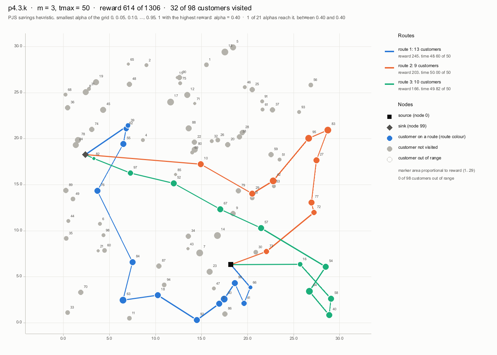
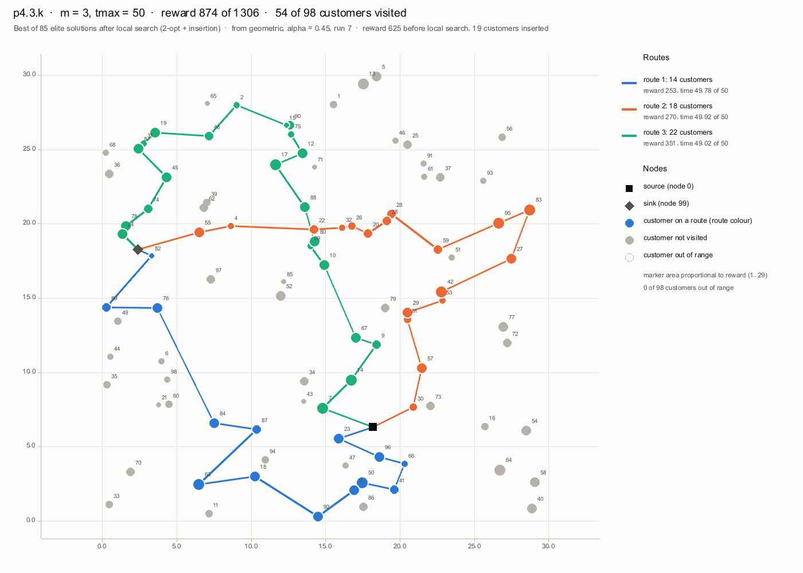
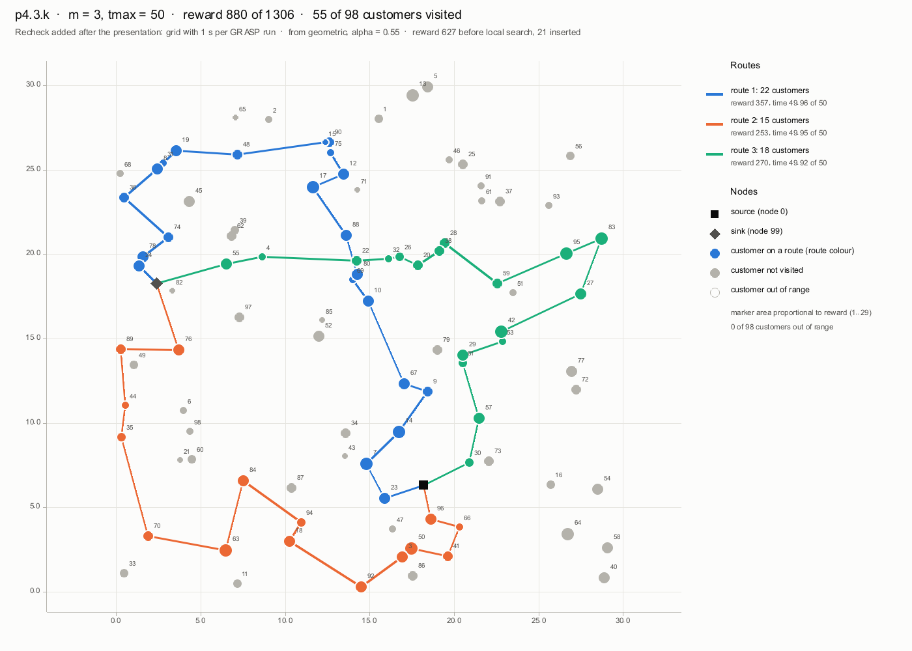
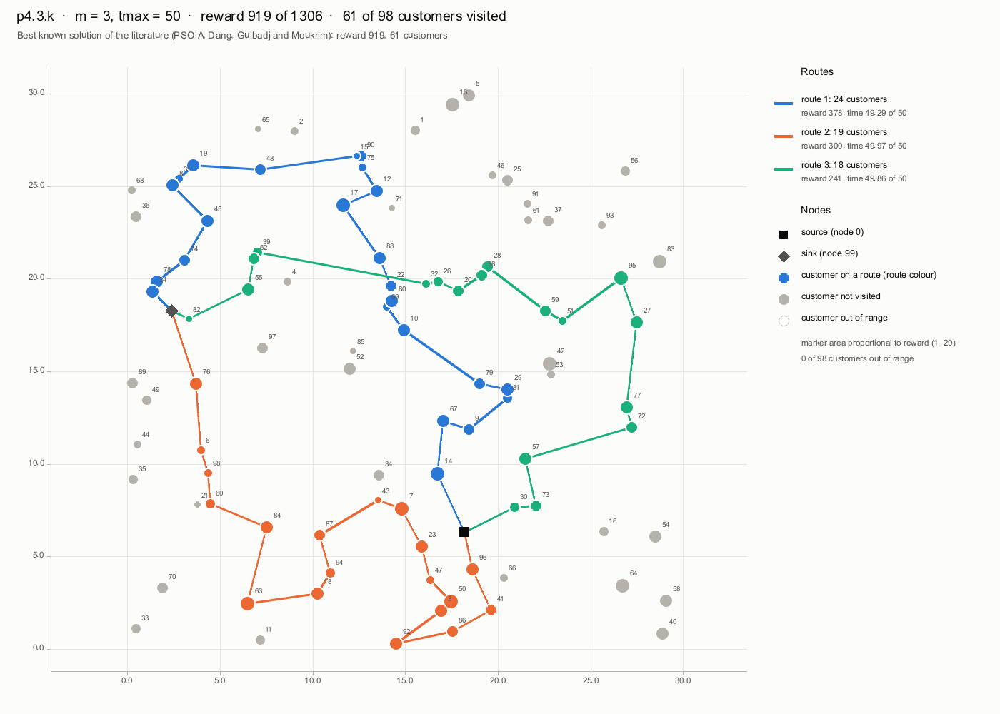

# p4.3.k: solución determinista, GRASP + búsqueda local y mejor solución conocida

> **Documento añadido después de la presentación**, solo para comprobar el ejemplo de la diapositiva *One instance, before and after: p4.3.k* (614 → 874, +42 %). Lo genera el ejecutable aparte `recheck` (`src/rust/src/bin/recheck.rs`), que no forma parte del flujo principal (`pjs`) ni cambia sus resultados.

Se regenera, desde `TOP/`, con:

```
ignore/target/release/recheck.exe --time 1 --runs 10 --seed 1 --grid-csv results/best_solution.csv --png results/figures/recheck_p4.3.k_1s_grid.png \
    --bks-sol src/data/psoia_p4.3.k.sol.txt --bks-png results/figures/recheck_p4.3.k_bks.png --report docs/recheck_p4.3.k.md \
    src/data/top-data/p4.3.k.txt results
```

Con tiempo de reloj por ejecución el recheck **no es reproducible exactamente**: el número de iteraciones depende de la carga de la máquina, así que al regenerarlo pueden cambiar las cifras de la sección 4 y la solución del recheck.

## 1. La instancia

- 98 clientes (98 alcanzables solos dentro de tmax), m = 3 vehículos, tmax = 50.
- Recompensa total de todos los clientes: 1306. Ninguna solución puede recogerla entera: el BKS recoge el 70.4 %.
- Los tiempos son distancias euclídeas; cada ruta sale del origen (nodo 0) y acaba en el destino (nodo 99).

## 2. Las cuatro soluciones

- **PJS determinista:** la heurística de ahorros de Panadero et al. (2021) con el mejor α de la rejilla 0, 0.05, …, 1 (α = 0.40).
- **Rejilla (la de la presentación):** el experimento principal, `results/best_solution.csv` y `results/best_routes.csv`: para cada α, 10 ejecuciones de GRASP de 10 iteraciones con cada aleatorización (geométrica y softmax), élite y búsqueda local (2-opt + inserción).
- **Recheck:** lo mismo, pero cada ejecución de GRASP itera durante **1 s** en lugar de 10 iteraciones (unas 344 iteraciones de media), con las mismas semillas, las mismas reglas de élite y la misma búsqueda local. Tardó 35 s. La final sale de geometric, α = 0.55, ejecución 4: 627 antes de la búsqueda local, 21 clientes insertados.
- **BKS:** la mejor solución conocida de la literatura, 919, en la columna BEST de `MA10-PSOMA-PSOiA-Chao-benchmark.xls` (Dang, Guibadj y Moukrim; es la de `src/data/bks_chao.csv`). Sus rutas son las de su fichero de solución, copiado sin cambios en [`src/data/psoia_p4.3.k.sol.txt`](../src/data/psoia_p4.3.k.sol.txt); allí los clientes se numeran desde 0, así que el cliente *a* es el nodo *a* + 1 del fichero de la instancia. Recalculadas aquí, las tres rutas dan exactamente la recompensa y la longitud que declara el fichero.

## 3. Comparación

| Solución | Recompensa | % del BKS | Distancia al BKS | Mejora sobre PJS | Clientes | Tiempo total (máx. 150) |
|---|---|---|---|---|---|---|
| PJS determinista (mejor α) | **614** | 66.8 % | 33.2 % | +0.0 % | 32 | 148.41 |
| Rejilla, 10 iteraciones + búsqueda local (la de la presentación) | **874** | 95.1 % | 4.9 % | +42.3 % | 54 | 148.71 |
| Recheck, 1 s + búsqueda local | **880** | 95.8 % | 4.2 % | +43.3 % | 55 | 149.83 |
| Mejor conocida (BKS, PSOiA) | **919** | 100.0 % | 0.0 % | +49.7 % | 61 | 149.12 |

Sin búsqueda local, lo mejor era 689 en la rejilla y 702 en el recheck. La mejora de la presentación (614 → 874, +42 %) se confirma: con 1 s por ejecución la final llega a 880 (+43.3 % sobre PJS). El BKS está un 4.4 % por encima de nuestra mejor solución.

### Lo que reporta el paper

**Panadero et al. (2021) no publica la solución de p4.3.k.** Sus tablas 3 y 4 dan la recompensa instancia a instancia (BKS, 1 a 128 hilos) solo para los conjuntos p1 y p2. Para p4 solo da, en la figura 4, la distancia media al BKS con 128 hilos de 1 s: **7.97 %** sobre las instancias del conjunto, y comenta que p4 es el conjunto más difícil ("a mean value close to 8%"). Tampoco publica sus rutas. Li et al. (2022) usa la misma heurística sobre otras instancias (TOP dinámico) y no da resultados de p4.

- **Estimación, no un dato del paper:** si en p4.3.k tuviera la distancia media de su conjunto, Panadero con 128 hilos obtendría unos 919 × (1 − 7.97 %) ≈ **846**.
- **Nuestras distancias en p4.3.k:** 4.90 % la rejilla (874, la de la presentación) y 4.24 % el recheck (880).
- **Comparación válida, por conjuntos** ([`comparacion_bks_conjuntos.md`](comparacion_bks_conjuntos.md)): en las 56 instancias de p4, nuestra rejilla final queda de media a un **5.87 %** del BKS, frente al 7.97 % de Panadero con 128 hilos.

### Clientes frente al BKS

| Solución | Clientes | En común con el BKS | Solo en esta (recompensa) | Solo en el BKS (recompensa) |
|---|---|---|---|---|
| PJS determinista (mejor α) | 32 | 22 | 10 (185) | 39 (490) |
| Rejilla, 10 iteraciones + búsqueda local (la de la presentación) | 54 | 47 | 7 (81) | 14 (126) |
| Recheck, 1 s + búsqueda local | 55 | 45 | 10 (111) | 16 (150) |

Clientes del BKS que no visita la solución del recheck, de mayor a menor recompensa: 77 (24), 45 (20), 72 (16), 62 (13), 79 (13), 87 (11), 73 (10), 86 (10), 39 (8), 60 (7), 51 (5), 98 (5), 6 (3), 47 (3), 43 (1), 82 (1).

Clientes que visita el recheck y no el BKS: 4 (3), 35 (7), 36 (10), 42 (27), 44 (5), 53 (2), 66 (2), 70 (13), 83 (29), 89 (13).

### Rutas

Clientes en orden de visita, con los índices de nodo del fichero de la instancia (el origen 0 y el destino quedan implícitos).

| Solución | Ruta | Recompensa | Clientes | Tiempo | Holgura hasta tmax | Clientes visitados |
|---|---|---|---|---|---|---|
| PJS determinista (mejor α) | 1 | 245 | 13 | 48.5980 | 1.4020 | 66 41 96 50 3 92 18 63 84 76 55 62 39 |
| PJS determinista (mejor α) | 2 | 203 | 9 | 49.9972 | 0.0028 | 73 72 77 27 83 95 42 29 10 |
| PJS determinista (mejor α) | 3 | 166 | 10 | 49.8179 | 0.1821 | 16 58 40 64 54 57 67 52 97 82 |
| Rejilla, 10 iteraciones + búsqueda local (la de la presentación) | 1 | 253 | 14 | 49.7772 | 0.2228 | 23 96 66 41 50 3 92 18 63 87 84 76 89 82 |
| Rejilla, 10 iteraciones + búsqueda local (la de la presentación) | 2 | 270 | 18 | 49.9166 | 0.0834 | 30 57 81 29 53 42 27 83 95 59 28 38 20 26 32 22 4 55 |
| Rejilla, 10 iteraciones + búsqueda local (la de la presentación) | 3 | 351 | 22 | 49.0152 | 0.9848 | 7 14 9 67 10 69 80 88 17 12 75 90 15 2 48 19 31 8 45 74 78 24 |
| Recheck, 1 s + búsqueda local | 1 | 357 | 22 | 49.9616 | 0.0384 | 23 7 14 9 67 10 69 80 88 17 12 75 90 15 48 19 31 8 36 74 78 24 |
| Recheck, 1 s + búsqueda local | 2 | 253 | 15 | 49.9468 | 0.0532 | 96 66 41 50 3 92 18 94 84 63 70 35 44 89 76 |
| Recheck, 1 s + búsqueda local | 3 | 270 | 18 | 49.9166 | 0.0834 | 30 57 81 29 53 42 27 83 95 59 28 38 20 26 32 22 4 55 |
| Mejor conocida (BKS, PSOiA) | 1 | 378 | 24 | 49.2856 | 0.7144 | 14 67 9 81 29 79 10 69 80 22 88 17 12 75 90 15 48 19 31 8 45 74 78 24 |
| Mejor conocida (BKS, PSOiA) | 2 | 300 | 19 | 49.9726 | 0.0274 | 96 41 86 92 3 50 47 23 7 43 87 94 18 63 84 60 98 6 76 |
| Mejor conocida (BKS, PSOiA) | 3 | 241 | 18 | 49.8592 | 0.1408 | 30 73 57 72 77 27 95 51 59 28 38 20 26 32 39 62 55 82 |

### Figuras

**PJS determinista, α = 0.40**



**Rejilla + búsqueda local**



**Recheck, 1 s + búsqueda local**



**BKS (PSOiA)**



## 4. Recheck por α (1 s por ejecución)

Recompensa de la determinista y de la mejor de las 10 ejecuciones de cada aleatorización, sin búsqueda local.

| α | Determinista | Mejor geometric | Mejor softmax | Iteraciones por ejecución (media) |
|---|---|---|---|---|
| 0.00 | 403 | 523 | 507 | 330 |
| 0.05 | 481 | 524 | 539 | 337 |
| 0.10 | 475 | 558 | 533 | 338 |
| 0.15 | 477 | 577 | 549 | 333 |
| 0.20 | 495 | 595 | 563 | 339 |
| 0.25 | 568 | 626 | 609 | 336 |
| 0.30 | 560 | 629 | 596 | 343 |
| 0.35 | 579 | 629 | 591 | 339 |
| 0.40 | 614 | 642 | 614 | 345 |
| 0.45 | 589 | 657 | 606 | 334 |
| 0.50 | 608 | 643 | 608 | 342 |
| 0.55 | 602 | 627 | 621 | 350 |
| 0.60 | 602 | 634 | 622 | 349 |
| 0.65 | 553 | 686 | 610 | 354 |
| 0.70 | 587 | 639 | 603 | 347 |
| 0.75 | 540 | 664 | 633 | 349 |
| 0.80 | 566 | 667 | 604 | 355 |
| 0.85 | 608 | 692 | 608 | 346 |
| 0.90 | 612 | 692 | 612 | 349 |
| 0.95 | 586 | 702 | 618 | 353 |
| 1.00 | 577 | 693 | 594 | 351 |

## 5. Comprobación de factibilidad

- **Todas las soluciones del recheck:** 639 de 639 factibles con `Solution::check` (como mucho m rutas, ningún cliente repetido ni depósito dentro de una ruta, cada ruta dentro de tmax, tiempos y recompensas iguales a los recalculados): las 21 deterministas, la mejor de cada una de las 420 ejecuciones de GRASP y las 99 élite (de 214 seleccionadas, sin duplicados), antes y después de la búsqueda local. Si alguna fallara, `recheck` terminaría con error sin escribir nada.
- **La rejilla y el BKS** pasan la misma comprobación al leerlos.
- **Comprobación externa** de la final del recheck con `verify_routes`, que no comparte código con `pjs` (lee la instancia con su propio parser y recalcula las distancias):

```
ignore/target/release/verify_routes.exe src/data/top-data results/recheck_p4.3.k_1s_grid_routes.csv results/recheck_p4.3.k_1s_grid_solution.csv
```
